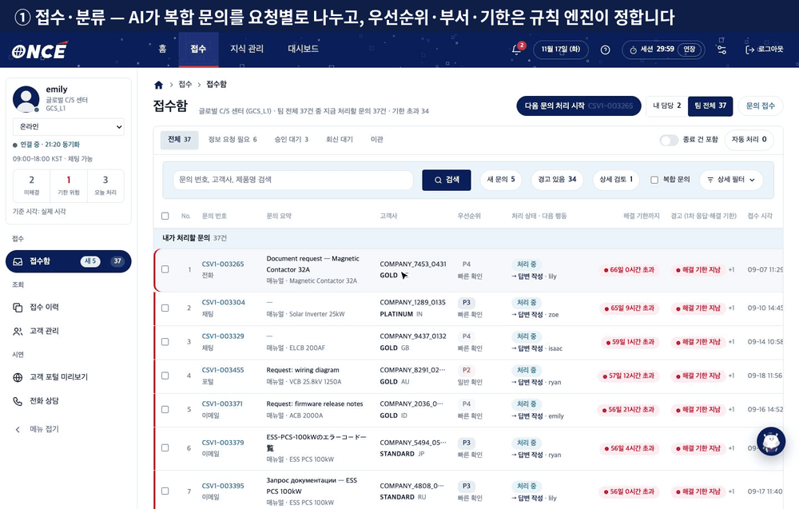
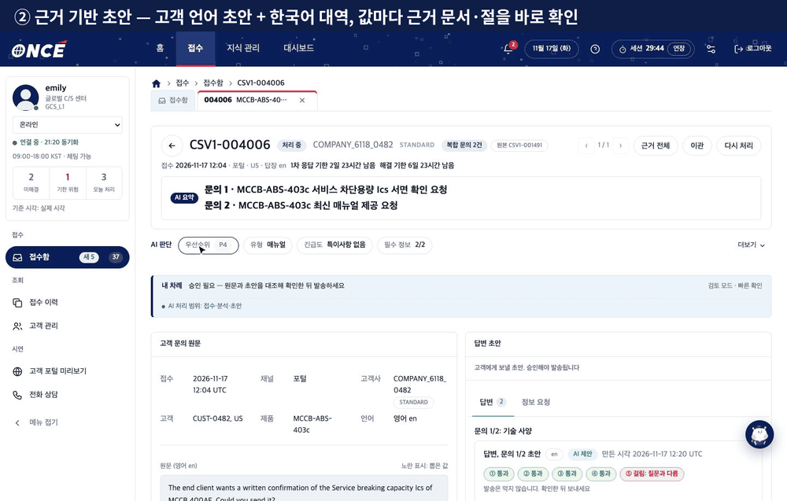
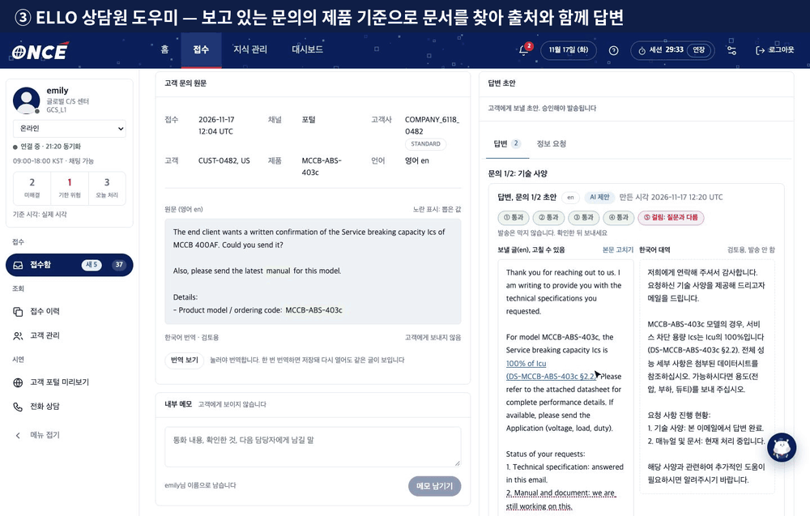
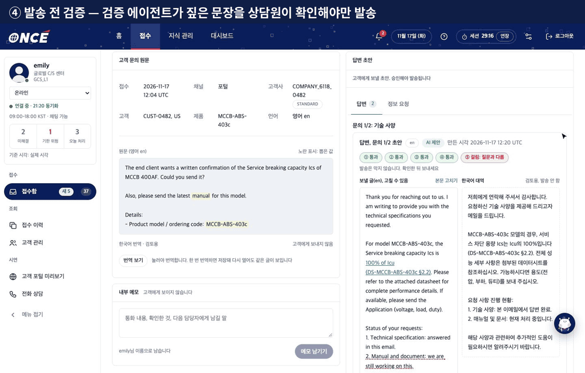
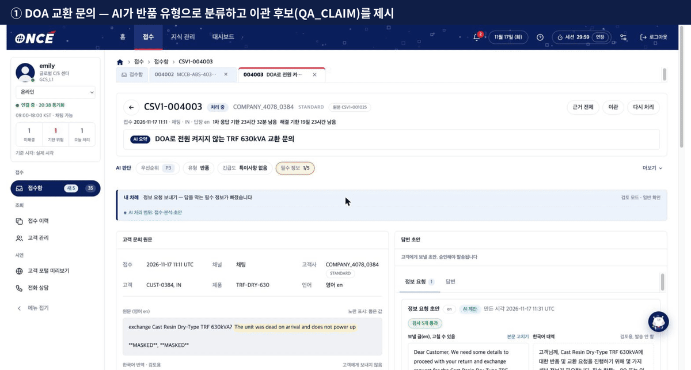
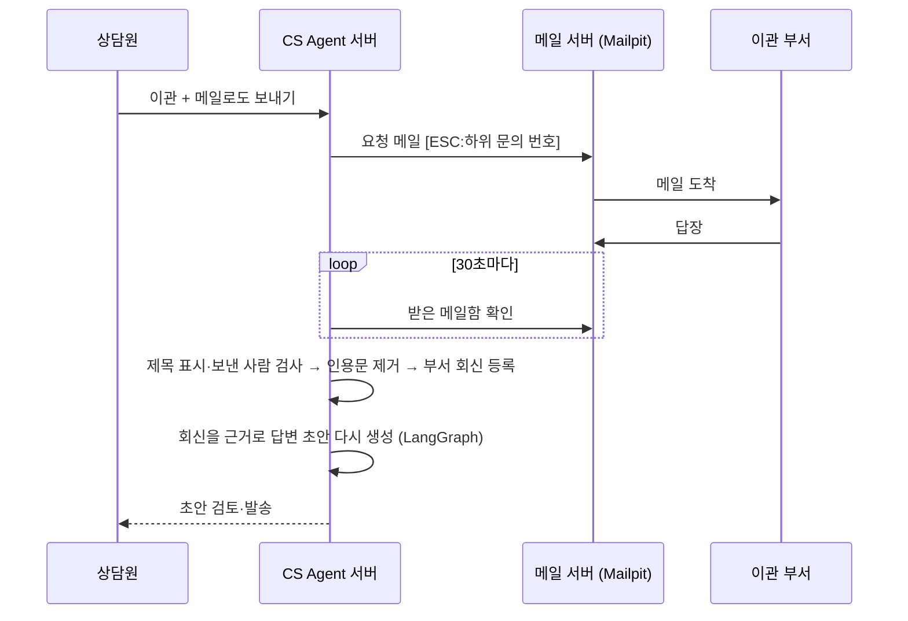
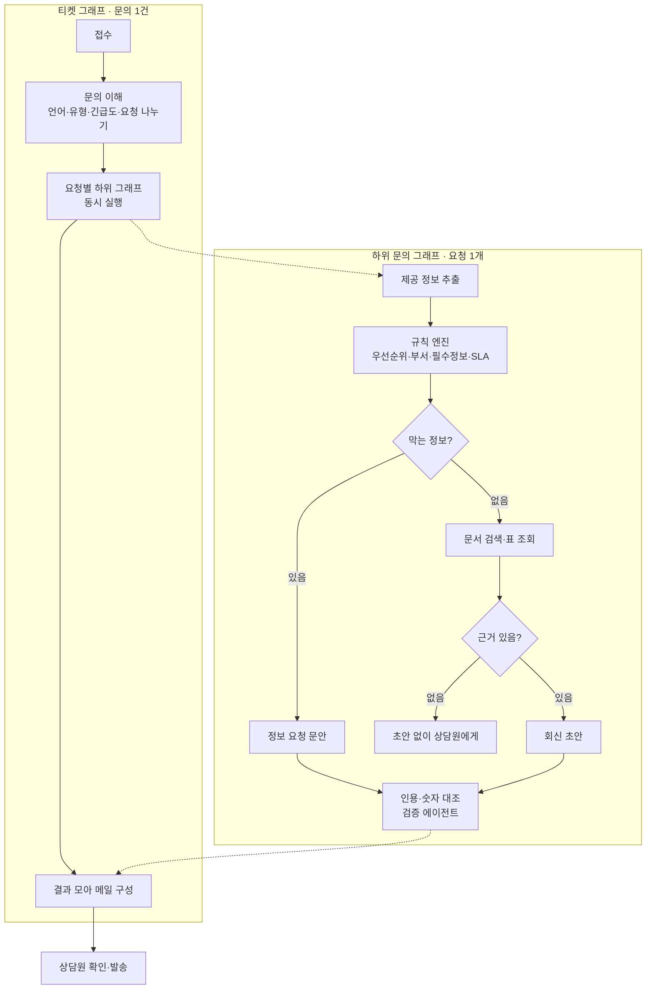

# 해외 고객 C/S 대응 AI Agent

해외 고객의 C/S 문의를 접수부터 회신, 부서 이관까지 돕는 AI Agent 서비스입니다.
**정확해야 빨라진다: 근거로 검증된 답만 내보내는 C/S 에이전트**를 목표로 만들었습니다.
**LS ELECTRIC 기업 연계 프로젝트**로, LS ELECTRIC이 제공한 교육용 합성 데이터(고객 문의 4,000건, 해결 사례 800건, 제품·정책 문서 107개)를 사용했습니다.
SKKU × LS AI CAMPUS 1기 2조의 팀 프로젝트(주제 1)를 개인 저장소로 옮겨 정리했습니다.


> 원본 팀 저장소: [skkuls-final-team/CS-agent-service](https://github.com/skkuls-final-team/CS-agent-service) · 팀원 4명 · 2026.10 ~ 2026.11
> 팀 프로젝트 이후 개인적으로 고도화한 내용은 [원본 이후 개인 고도화](#원본-이후-개인-고도화)에 있습니다.

<table>
  <tr>
    <td width="50%" valign="top">
      <a href="docs/assets/readme/cs-1-intake.gif"></a>
      <p><b>① 접수·분류</b></p>
      <ul>
        <li>AI가 문의 언어, 유형 10종, 긴급도를 판정하고 여러 요청이 섞인 문의는 요청별로 나눠 동시에 처리합니다.</li>
        <li>우선순위·담당 부서·필수 정보·응답 기한(SLA)은 AI가 아닌 <b>규칙 엔진</b>이 정합니다.</li>
      </ul>
    </td>
    <td width="50%" valign="top">
      <a href="docs/assets/readme/cs-2-draft.gif"></a>
      <p><b>② 근거 기반 회신 초안</b></p>
      <ul>
        <li>제품·정책 문서 107개(절 895개)를 검색하고, 가격·납기·사양·펌웨어는 표에서 조회합니다.</li>
        <li>근거가 있을 때만 고객 언어로 초안을 쓰고, 값마다 근거 문서·절을 바로 확인할 수 있습니다.</li>
      </ul>
    </td>
  </tr>
  <tr>
    <td width="50%" valign="top">
      <a href="docs/assets/readme/cs-3-ello.gif"></a>
      <p><b>③ ELLO 상담원 도우미</b></p>
      <ul>
        <li>상담원 전용 챗봇. 보고 있는 문의의 제품·오류 코드에 맞춰 질문 후보를 띄웁니다.</li>
        <li>문서를 검색해 출처와 함께 답하고, 고객에게 가는 글에는 쓰지 않습니다.</li>
      </ul>
    </td>
    <td width="50%" valign="top">
      <a href="docs/assets/readme/cs-4-check.gif"></a>
      <p><b>④ 발송 전 검증 · 사람 승인</b></p>
      <ul>
        <li>초안의 인용·숫자를 코드로 대조하고, 검증 에이전트가 근거와 다른 문장·확정적 약속 표현을 찾습니다.</li>
        <li>고객에게 가는 글은 모두 초안이며, <b>상담원이 확인한 뒤에만</b> 발송됩니다.</li>
      </ul>
    </td>
  </tr>
</table>

## 내 역할 — 나송주 · 주제 1 BE·FE · 현장 앱·사무실 웹 화면

| 맡은 일 | 내용 |
| --- | --- |
| FastAPI 서버와 API | 화면이 쓰는 백엔드 API 설계와 구현 |
| React·PWA 앱 | 현장에서 쓰는 앱과 사무실 웹 화면 구현 |
| 오프라인 문서 저장 | 네트워크가 끊긴 현장에서도 문서를 볼 수 있도록 기기에 저장 |

<!-- TODO: 위 표에 직접 만든 화면 이름, API 예시, 해결한 문제(예: 오프라인 동기화 방식)와 결과를 한두 줄씩 더하면 좋습니다. -->

> 팀은 공용 Claude 계정으로 OpenSpec 기반 개발(스펙 → 구현 → archive)을 진행해, 원본 저장소의 커밋 작성자는 Claude·팀 계정으로 기록되어 있습니다.

## 원본 이후 개인 고도화

팀 프로젝트가 끝난 뒤(원본 마지막 커밋 2026-11-01) 이 저장소로 옮겨 이어서 개발한 내용입니다. 원본과 같은 방식으로 OpenSpec 제안서를 먼저 쓰고 구현했습니다.

### 1. 이관 메일 실제 발송·수신 — [제안서](openspec/changes/add-escalation-mail-live/proposal.md)

원본에서는 "이관 요청을 메일로도 보내기"가 **화면 시안**이었습니다. 체크해도 메일은 나가지 않았고, 부서 회신은 [회신 메일 도착 (시연)] 버튼으로 흉내만 냈습니다. 이관받은 부서가 시스템에 들어오지 않고 **메일만으로 일할 수 있도록** 실제로 동작하게 만들었습니다.

<p align="center"></p>



| 고민한 점 | 선택 |
| --- | --- |
| 답장을 어느 문의에 붙일까 | 요청 메일 제목에 `[ESC:하위 문의 번호]`를 넣고, 답장 제목에서 다시 찾음 |
| 아무나 답장을 보내면? | **이관받은 부서 메일함에서 온 메일만** 연결하고, 나머지는 건너뛴 까닭을 기록 |
| 메일 발송이 실패하면? | 이관은 확정하되 응답과 화면에 실패를 알림. 발송한 메시지는 DB 트리거로 수정이 막혀 있어서, 발송을 이관과 같은 트랜잭션 안에서 먼저 하고 **실제 결과로 기록**함 |
| 답장 본문의 인용문 | `>` 줄, "On … wrote:", "…님이 작성:" 등 영어·한국어 메일 프로그램 형식을 떼고 새 글만 저장 |
| 같은 메일을 두 번 처리하지 않게 | 처음엔 "안 읽은 메일"만 확인했는데, 직접 시연하다가 **메일함에서 답장을 열어 보기만 해도 읽음이 되어 영영 연결되지 않는 버그**를 발견함. 읽음 상태 대신 C/S 주소와 "처리함" 태그로 고르도록 바꾸고 회귀 시험을 추가함. 이미 회신이 등록된 문의에 늦게 온 답장은 건너뜀 |
| 기존 흐름과의 일관성 | 새 처리 경로를 만들지 않고 기존 [회신 등록] 함수를 그대로 써서 상태 전이·실행 로그·재처리가 화면 회신과 같음 |
| DB 변경 | 표·열 추가 없이 설정(부서 도메인)만으로 부서 주소를 만듦 |

- **시험**: 가짜 SMTP·메일함으로 "보내기 → 답장 → 연결 → 다시 처리" 전체와 사칭·중복·늦은 답장·발송 실패·연동 꺼짐을 확인하는 시험 11개를 추가했습니다. 전체 시험 442개가 통과합니다(원본에서도 실패하던 대시보드 날짜 시험 1개 제외).
- **실제 확인**: Mailpit과 서버를 띄워 이관 → 요청 메일 도착 → 한국어 메일 프로그램 형식의 답장 → 주기 확인으로 회신 등록·재처리 실행까지 확인했습니다.
- **다음 단계**: 받은 메일함·발송 인터페이스(`Inbox`, `Sender`)를 Microsoft Graph나 Gmail API 구현으로 바꾸면 실제 회사 메일에 연결할 수 있습니다.

## 처리 흐름

문의 1건마다 **티켓 그래프**가 돌고, 나뉜 요청마다 **하위 문의 그래프**가 동시에 돕니다.



**LangGraph를 쓴 이유**는 똑똑한 자율 에이전트가 필요해서가 아니라, 반대로 **처리 순서를 고정해 모델의 재량을 줄이면서도** 복합 문의의 요청을 동시에 돌리고 단계마다 실행 기록을 남기기 위해서였습니다. 우선순위·부서·기한처럼 규칙표로 100% 재현되는 것은 모델에 묻지 않습니다.

## 주요 기능

- **안전 우선 규칙**: 안전·설비 정지 문의는 놓치지 않도록 조금이라도 해당하면 높은 긴급도로 분류하고, 상담원 화면에 "확인 필요"로 표시
- **개인정보 가림**: 이메일·이름·전화번호는 Gemini에 보내기 직전과 실행 로그 저장 직전에 가림
- **부서 이관과 회신**: 이관 후보를 띄우고, 부서 회신이 오면 그 요청을 근거 검색부터 다시 처리. 이관 요청과 부서 회신은 실제 메일로 주고받음(개인 고도화)
- **ELLO 상담원 도우미**: 상담원 전용 챗봇. 보고 있는 문의의 제품·오류 코드에 맞춘 질문 후보를 띄우고, 제품·정책 문서를 검색해 근거와 함께 답함
- **시간 관리**: SLA 경고, 126시간 리마인드, 168시간 자동 종료를 스케줄러가 처리
- **그 밖에**: 고장 진단·유사 해결 사례 검색, 통화 받아쓰기, 한국어 대역 표시, 상담원 업무 현황·운영 대시보드

## 기술 스택

| 구분 | 사용 기술 |
| --- | --- |
| 백엔드 | Python 3.11, FastAPI, psycopg 3, 스케줄러 |
| AI | Google Gen AI SDK(Gemini `gemini-3.8-flash`, 임베딩 `gemini-embedding-2`), LangGraph |
| 데이터·검색 | PostgreSQL 16 + pgvector, 기준정보 표 24개, 문의 4,000건·해결 사례 800건 |
| 프론트 | React 18, TypeScript 5, Vite 5, TanStack Query 5, OpenAPI로 API 타입 생성 |
| 인프라 | Docker Compose, Mailpit(로컬 메일 서버, 개인 고도화) |
| 개발 방식 | OpenSpec 기반 SDD, 명세서 완료 기준(AC) 하나마다 테스트 하나 |

## 실행

```bash
cp .env.example .env                 # GEMINI_API_KEY 입력
docker compose up -d --build         # db(pgvector) + api(:8000) + mailpit(:8025)

python -m jobs.load_reference        # 기준정보 적재
python -m jobs.load_gold             # 문의·해결 사례 적재
python -m jobs.build_doc_index       # 문서 107개 → 절 895개 색인
python -m jobs.replay_demo           # 시연용 미해결 문의

cd frontend && npm install && npm run dev   # http://localhost:5173
```

이관할 때 보낸 메일과 부서 답장은 http://localhost:8025 (Mailpit)에서 볼 수 있습니다. 메일은 밖으로 나가지 않습니다.

학습 데이터(`data/`)와 `.env`는 저장소에 포함하지 않습니다. 시험은 `pip install -e "backend[test]" && cd backend && pytest`로 돌립니다.

## 문서

- [기능 요구사항 명세서](docs/requirements/functional-requirements.md) · [기술 명세서](docs/technical/technical-specification.md)
- [에이전트 설계서](docs/technical/agent-design.md) · [테이블 정의서](docs/database/table-specification.md) · [화면 정의서](docs/technical/screen-specification.md)

---

화면과 평가에는 LS ELECTRIC이 교육용으로 제공한 합성 데이터와 시연용 가상 인물을 사용했습니다. 실제 LS ELECTRIC 제품·고객·업체 정보와는 관계가 없으며, 원본 데이터는 저장소에 포함하지 않습니다.
