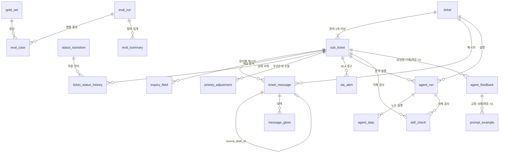
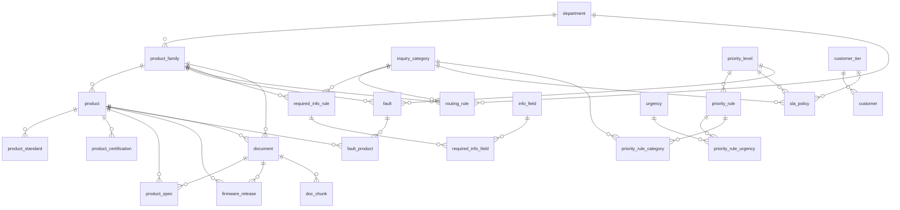

# 테이블 정의서 v1.3 — 해외고객향 C/S 대응 AI Agent

- 작성일: 2026-10-22(v1.2: 2026-10-20) · DB: PostgreSQL 16 + pgvector
- 기준: 기능 요구사항 명세서 v1.5, 기술 명세서 v1.4(§6 저장 구조, §7 마스킹, §9 W6·W8·W9, §10-3). 이 두 문서 말고는 근거로 쓰지 않는다.
- 열 이름은 tickets.csv 열 이름을 그대로 쓴다. 한국어 이름 뒤 괄호 안은 실제 파일·열 이름이다.
- 결정 번호: "D30"처럼 번호만 쓴 것은 기능 요구사항 명세서 v1.5의 결정, "T43"처럼 T가 붙은 것은 기술 명세서의 결정이다.
- 처음 읽는 팀원은 끝의 **부록 A(읽는 법)**를 먼저 보면 된다. v1.2에서 바뀐 곳은 끝의 **변경 이력**에 모았다.
- 생성 SQL은 이 문서를 확정한 뒤 이 문서대로 만든다.

---

## 1. 전체 구성

| 스키마 | 담는 것 | 표 수 | 쓰는 쪽 | 설명 |
|---|---|---|---|---|
| ref | 기준정보·규칙표(ref/*.csv 12개) 23개 + 문서 목록(document) + 문서 검색 청크(doc_chunk) | 25 | 적재 작업만 쓴다. 서비스와 채점은 읽기만 | §2 |
| gold | 운영진 정답지 원본: tickets.csv 4,000건, resolution_cases.csv 800건 | 2 + 뷰 1 | 서비스는 `v_inputs`(입력 열)만 읽는다 | §3 |
| svc | 서비스 표 | 11 + 함수 2 + 뷰 2 | 서비스 | §4 |
| scoring | svc와 같은 모양. 채점 배치 전용 | 11 | 채점 배치(개발 작업)만 | §5 |
| eval | 팀 정답지, 채점 결과, 자체 검사, 상담원 기록 | 8 | 채점 배치, 서비스(self_check), 여유 시 기능 | §6 |

**정답지 격리(D30).** 학습용·검증용·평가용 구분(data_split)은 쓰지 않는다. 운영진 데이터 4,000건은 서비스 이력·시연·팀 정답지의 재료로 모두 쓴다. 대신 **팀 정답지(`eval.gold_set`)에 들어간 문의는 svc의 시연 이력, 유사 사례 색인(FR-019), few-shot 예시에 넣지 않는다.** 거르는 방법은 하나로 통일한다: `eval.gold_set.source_ticket_id`와 맞대 본다. 서비스는 gold의 정답 열을 읽지 않고, 입력 열만 `gold.v_inputs`로 읽는다.

**고객 메시지 승인(D32).** 고객에게 나가는 메시지의 발송 행(SENT)은 상담원 승인 API와 126시간 리마인드 스케줄러 두 곳만 쓴다. 자동 발송은 없으므로 자동 발송 전이와 보류 열도 두지 않는다.

**여유 시 기능 표.** eval의 agent_feedback(FR-043)·prompt_example(FR-046)과 ticket_message.notice_transition의 진행 안내 4값(FR-048)은 여유 시 기능용이다. 표는 지금 만들어 두고 MVP 코드는 쓰지 않는다(기술 명세서 T41).

### 1-1. 관계 그림 (svc + eval)

Notion 코드 블록에서 언어를 Mermaid로 고르면 그림으로 보인다. svc의 고객·제품·부서·규칙 열은 모두 ref 표를 FK로 가리킨다(그림에서는 생략, ref 관계는 §2-0).

---

## 2. ref 스키마 — 기준정보·규칙표

원본: README.html이 설명하는 ref/ 폴더의 CSV 12개(reference_master.xlsx는 같은 내용을 합친 파일이라 제외)와 docs/doc_index.csv. 행 수는 실제 적재 결과다. 서비스는 ref를 바꾸지 않는다.

### 2-0. 관계 그림과 원본에서 바꾼 점

**관계 그림 (ref).** 선은 FK다. `||--o{`는 "왼쪽 한 행에 오른쪽 여러 행"이라는 뜻이다. Notion 코드 블록에서 언어를 Mermaid로 고르면 그림으로 보인다.

sla_setting은 다른 표와 연결되지 않는 설정값 3행이라 그림에 없다.

**관계를 읽는 법 (자주 쓰는 길 3개)**

| 하고 싶은 일 | 따라가는 길 |
|---|---|
| 문의의 담당 부서 찾기(FR-012) | product → product_family → routing_rule(같은 category) → department. primary_dept가 비어 있으면 product_family.tech_support_dept |
| 필수정보 대조(FR-013) | product_family + inquiry_category → required_info_rule → required_info_field(is_blocking, field_order) → info_field.label |
| SLA 목표 찾기(FR-014) | inquiry_category + customer.tier + 최종 우선순위 → sla_policy 한 행 |

**원본 CSV와 다르게 저장한 것.** 한 칸에 여러 값이 있거나, 같은 사실이 두 곳에 있거나, 다른 표가 가리킬 코드표가 없던 곳만 바꿨다.

| 원본 (파일.열) | 바꾼 모습 | 이유 |
|---|---|---|
| product_master.csv family_name, tech_support_dept | product_family 표로 분리 | 제품 23행에 같은 제품군 이름·담당 부서가 반복됐다. 11개 제품군 모두 1:1로 정해진다. 담당 부서를 바꿀 때 한 행만 고치면 된다 |
| product_master.csv standards, certifications | product_standard, product_certification 표 | 'CE;CB;KC'처럼 한 칸에 여러 값이 있었다. 행으로 펼치면 "UL 인증 제품" 같은 조회가 정확해진다 |
| product_master.csv doc_ids | 저장하지 않음 | docs/doc_index.csv의 product_code와 같은 사실이다. document 표 한 곳에 둔다 |
| product_master.csv fw_latest | 저장하지 않음 | firmware_history.csv의 is_latest = Y 버전과 13개 제품 모두 같다. 한 곳(firmware_release)에만 둔다 |
| sla_policy.csv resolution_definition | inquiry_category 표 | 원본에 문의 유형 코드표가 없었고, 이 값은 유형에만 따라 정해진다 |
| sla_policy.csv clock, at_risk_threshold, pause_rule | sla_setting 3행 | 120행 모두 같은 값이었다 |
| priority_rules.csv priority_definition | priority_level 표 | 우선순위에만 따라 정해지는 값이다. sla_policy, fault도 같은 P1~P4를 가리킨다 |
| priority_rules.csv condition | priority_rule_urgency, priority_rule_category 표 | 원문은 사람이 읽는 문장이라 프로그램이 판정할 수 없다. 조건을 표로 옮겼고 원문은 condition 열에 그대로 둔다. PR-06·PR-07에서 생략된 유형은 정보성 4종(TECH_SPEC, MANUAL, COMPLIANCE, QUOTE)으로 적었다 |
| priority_rules.csv order | priority_rule.rule_order | order는 SQL 예약어라 이름만 바꿨다 |
| customers.csv tier, sla_policy.csv customer_tier | customer_tier 코드표 | 두 열이 같은 값이어야 SLA 조회가 된다. 등급 오타를 DB가 막는다 |
| fault_catalog.csv applies_to | fault_product 표 | 한 칸에 제품 여러 개(97건 중 40건). 펼치면 156행이다. "이 제품의 이 오류 코드" 조회가 정확해진다 |
| fault_catalog.csv fw_fix_version | fault_product.fw_fix_version | FLT-078은 PCS와 BMS에 해당하지만 수정 버전 2.62는 PCS 펌웨어에만 있다. 값이 "고장 × 제품"마다 달라서 제품 행으로 옮겼다 |
| routing_rules.csv family = 'ALL' | 비어 있음(NULL) | 어떤 제품군에도 없는 값이라 FK를 걸 수 없다. "모든 제품군"으로 읽는다 |
| routing_rules.csv primary_dept = '(제품군 기술지원)' | 비어 있음(NULL) | 부서 코드가 아니다. product_family.tech_support_dept에서 찾는다 |
| required_info.csv required_fields, blocking_fields | required_info_rule + required_info_field(437행) | 한 칸에 여러 값. 차단 항목은 늘 필수 항목의 일부라 is_blocking 표시로 합쳤다. field_order로 원래 순서를 지킨다(정보 요청 메시지의 항목 순서) |
| required_info.csv field_labels | 저장하지 않음 | info_field_codebook.csv의 label과 110행 모두 같다 |
| fw_version, section 같은 번호 | TEXT로 저장 | 숫자로 읽으면 '3.10'이 '3.1'로, '2.10'이 '2.1'로 바뀐다 |

**일부러 나누지 않은 것**
- sla_policy.csv 120행: 계산식으로 줄일 수 있지만 고객사가 준 공식 정책표라 원본과 한 행씩 대조할 수 있게 그대로 둔다. 특정 조합만 예외로 바꾸기도 쉽다.
- customers.csv country, segment: 다른 표가 가리키지 않아 코드표로 빼도 얻는 것이 없다.
- product_spec_facts.csv doc_id, fault_catalog.csv family: 다른 열로 계산할 수 있지만, 답변 근거 인용과 제품군 단위 조회를 한 행에서 바로 하려고 남겼다.
- 서술형 열(fault의 symptom·action, firmware_release.changes, routing_rule.escalation_condition, product의 dimensions_mm 등): 답변에 그대로 인용하거나 사람이 읽고 판단하는 문장이라 쪼개지 않는다.

**적재 확인.** ref 데이터는 FK 위반 없이 모두 들어간다. 이 표들만으로 tickets.csv 4,000건의 우선순위 규칙(priority_rule_id), SLA 목표 시간, 필수정보(required_info)를 모두 재현했다.

### 2-1. 코드 표 (7개, 합의)

| 표 | 원본 | 행 | 열 (PK 굵게) |
|---|---|---|---|
| department 부서 | departments.csv | 13 | **dept_code** 부서 코드, dept_name_ko 한국어 이름, dept_name_en 영어 이름, level 단계(L1/L2/L3), scope 담당 범위 |
| product_family 제품군 | product_master.csv의 family, family_name, tech_support_dept | 11 | **family** 제품군 코드, family_name 이름, tech_support_dept 기술지원 부서 → department |
| inquiry_category 문의 유형 | sla_policy.csv의 category, resolution_definition | 10 | **category** 문의 유형 코드, resolution_definition 해결 정의, sla_resolution_coef 해결시간 계수(참고값) |
| priority_level 우선순위 | priority_rules.csv의 priority, priority_definition | 4 | **priority** P1~P4, definition 정의 |
| customer_tier 고객 등급 | customers.csv tier | 3 | **tier** 등급 |
| urgency 긴급도 | urgency_codebook.csv | 6 | **urgency** 긴급도 코드, description 설명 |
| info_field 정보 항목 | info_field_codebook.csv | 32 | **field** 항목 코드, label 표시 이름 |

### 2-2. 마스터 표 (6개, 합의)

**customer 고객사** (customers.csv, 600행)

| 열 | 형식 | 필수 | 키 | 설명 |
|---|---|---|---|---|
| customer_id | TEXT | 필수 | PK | 고객사 번호 |
| company_masked | TEXT | 필수 | | 가린 회사 이름 |
| country | TEXT | 필수 | | 국가 코드(ISO 2자리) |
| tier | TEXT | 필수 | FK customer_tier | 고객 등급 |
| segment | TEXT | 필수 | | 고객 구분 |
| account_since | DATE | | | 거래 시작일 |
| contact_count | INTEGER | | | 담당자 수 |
| primary_contact_name, primary_contact_email, primary_contact_phone | TEXT | | | 고객사 대표 연락처(이름, 이메일, 전화). v1.3 추가(기술 명세서 v1.4 §6-2, 가-7). customers.csv에는 값이 없어 비어 있고, 원본 CSV는 고치지 않는다. 길이 제한·형식 검사는 두지 않는다 |

**product 제품** (product_master.csv, 23행). 원본의 family_name, tech_support_dept는 product_family로, standards, certifications는 아래 두 표로, fw_latest는 firmware_release.is_latest로, doc_ids는 document로 옮겼다.

| 열 | 형식 | 필수 | 키 | 설명 |
|---|---|---|---|---|
| product_code | TEXT | 필수 | PK | 제품 코드 |
| product_name | TEXT | 필수 | | 제품 이름 |
| family | TEXT | 필수 | FK product_family | 제품군 |
| description | TEXT | | | 설명 |
| has_firmware | BOOLEAN | 필수 | | 펌웨어 있음 |
| warranty_months | INTEGER | 필수 | | 보증 개월 |
| lifecycle_status | TEXT | 필수 | | 판매 상태 |
| std_lead_time_weeks | INTEGER | 필수 | | 표준 납기(주) |
| moq | INTEGER | 필수 | | 최소 주문 수량 |
| list_price_usd | INTEGER | 필수 | | 정가(USD) |
| weight_kg, dimensions_mm, ip_rating, operating_temp | | | | 무게, 크기, 방진방수 등급, 사용 온도 |

| 표 | 원본 | 행 | 열 (PK 굵게) |
|---|---|---|---|
| product_standard 제품 규격 | product_master.csv standards(';'로 이은 값) | 39 | **product_code** → product, **standard** |
| product_certification 제품 인증 | product_master.csv certifications | 61 | **product_code** → product, **certification** |
| product_spec 제품 사양값 | product_spec_facts.csv | 169 | **product_code** → product, **attribute** 사양 이름, value 값, doc_id → document, section 절 번호(TEXT, '2.10' 보존) |
| firmware_release 펌웨어 이력 | firmware_history.csv | 39 | **product_code** → product, **fw_version** (TEXT, '3.10' 보존), release_date 배포일, is_latest 최신 여부, changes 변경 내용, doc_id → document |

### 2-3. 진단 지식 (2개, 합의)

**fault 고장 유형** (fault_catalog.csv, 97행)

| 열 | 형식 | 필수 | 키 | 설명 |
|---|---|---|---|---|
| fault_id | TEXT | 필수 | PK | 고장 번호 |
| family | TEXT | 필수 | FK product_family | 제품군 |
| error_code | TEXT | | | 오류 코드. 코드 없는 증상형 고장은 비어 있다 |
| symptom, root_cause, diagnosis, action | TEXT | 필수 | | 증상, 원인, 진단 방법, 조치 |
| severity_hint | TEXT | 필수 | FK priority_level | 심각도 참고값 |
| needs_onsite, needs_rma | BOOLEAN | 필수 | | 현장 방문 필요, 반품 필요 |
| replacement_part | TEXT | | | 교체 부품 |
| typical_resolution_hours | INTEGER | 필수 | | 보통 해결 시간 |

**fault_product 고장-제품** (fault_catalog.csv applies_to, 156행): **fault_id** → fault, **product_code** → product, fw_fix_version 고친 펌웨어 버전(원본 fw_fix_version을 제품 행으로 옮김).

### 2-4. 운영 규칙 (8개, 합의)

| 표 | 원본 | 행 | 열 (PK 굵게) | 쓰는 곳 |
|---|---|---|---|---|
| priority_rule 우선순위 규칙 | priority_rules.csv | 7 | **rule_id**, rule_order 적용 순서(원본 order, 겹치지 않음), condition 조건 원문, priority → priority_level | FR-011. rule_order가 작은 규칙부터 보고 처음 맞는 규칙을 쓴다 |
| priority_rule_urgency 규칙의 긴급도 조건 | condition 분해 | 6 | **rule_id**, **urgency** → urgency | 행이 없으면 "모든 긴급도" |
| priority_rule_category 규칙의 유형 조건 | condition 분해 | 20 | **rule_id**, **category** → inquiry_category | 행이 없으면 "모든 유형" |
| routing_rule 부서 규칙 | routing_rules.csv | 111 | **rule_id**, family(원본 ALL → 비어 있음), category, rule_source(CATEGORY_DEFAULT / FAMILY_OVERRIDE / SUBTYPE_OVERRIDE / ESCALATION), primary_dept(원본 "(제품군 기술지원)" → 비어 있음, 이때 product_family.tech_support_dept), escalation_dept, escalation_condition | FR-012 |
| required_info_rule 필수정보 규칙 | required_info.csv | 110 | **family**, **category** | FR-013 |
| required_info_field 필수 항목 | required_fields, blocking_fields | 437 | **family**, **category**, **field** → info_field, field_order 순서, is_blocking 차단 항목 여부 | FR-013. 원본 field_labels는 info_field.label로 대신한다 |
| sla_policy SLA 정책 | sla_policy.csv | 120 | **sla_id**, category, customer_tier, priority, first_response_hours 1차 응답 목표(h), resolution_hours 해결 목표(h). (category, customer_tier, priority) 겹치지 않음 | FR-014 |
| sla_setting SLA 설정 | sla_policy.csv의 전 행 같은 값 3개 | 3 | **key**, value. clock = 24x7, at_risk_threshold = 75%, pause_rule = WAITING_CUSTOMER 시간 제외 | FR-026 |

### 2-5. 문서 (2개)

**document 문서 목록** (docs/doc_index.csv, 107행). product_spec, firmware_release의 doc_id가 이 표를 가리킨다.

| 열 | 형식 | 필수 | 키 | 설명 |
|---|---|---|---|---|
| doc_id | TEXT | 필수 | PK | 문서 번호 |
| title | TEXT | 필수 | | 제목 |
| doc_type | TEXT | 필수 | CHECK | DS / IG / TG / RN / MG / FAQ / POL |
| product_code | TEXT | | FK product | 정책·FAQ는 비어 있다 |
| family | TEXT | | FK product_family | 정책은 비어 있다 |
| revision | TEXT | | | 개정판 |
| path | TEXT | 필수 | | docs/ 아래 경로 |
| chars | INTEGER | 필수 | | 글자 수 |

**doc_chunk 문서 검색 청크.** 문서의 `##`, `###` 절 하나 = 한 행(기술 명세서 T35). 색인 작업이 채운다. 서비스와 채점이 함께 읽는다.

| 열 | 형식 | 필수 | 키 | 설명 |
|---|---|---|---|---|
| chunk_id | TEXT | 필수 | PK | `{doc_id}§{section_no}` 예: TG-ACB-AS-2000§3.1 |
| doc_id | TEXT | 필수 | FK document | |
| doc_type | TEXT | 필수 | | 검색 필터용 복사 |
| product_code | TEXT | | FK product | 검색 필터용 복사 |
| family | TEXT | | FK product_family | 검색 필터용 복사 |
| section_no | TEXT | 필수 | | 절 번호. '2.10' 보존. FAQ는 'Q3' (doc_id, section_no) 겹치지 않음 |
| section_title | TEXT | 필수 | | 절 제목 |
| text | TEXT | 필수 | | 절 본문 |
| embedding | vector | | | 검색용 숫자 벡터. 임베딩 모델은 `gemini-embedding-2`(기술 명세서 T38, v1.4 추가 결정 가1). 차원은 색인 작업(W2)을 시작할 때 모델 기본값으로 고정하고 그때 벡터 색인을 만든다 |

색인: (product_code, doc_type), (family, doc_type).

---

## 3. gold 스키마 — 운영진 정답지 원본

| 표·뷰 | 원본 | 행 | 설명 |
|---|---|---|---|
| ticket_gold | tickets.csv | 4,000 | 58열을 원본 이름 그대로, **모두 TEXT**로 둔다(원본 보존, 형 변환은 읽을 때). PK ticket_id. data_split 열은 원본 그대로 남지만 쓰지 않는다(D30) |
| resolution_case_gold | resolution_cases.csv | 800 | 27열 원본 그대로, 모두 TEXT. PK case_id |
| v_inputs (뷰) | ticket_gold | 4,000 | 입력 열만: ticket_id, channel, customer_id, product_code, language, inquiry_body, received_at_utc(시각으로 바꿈). 정답 열과 제목(inquiry_subject)은 없다. 서비스가 정답지를 읽는 유일한 창구(FR-003). |

**권한.** 서비스 DB 계정은 gold 스키마에서 `v_inputs` 뷰만 읽을 수 있다.

**팀이 만든 문의를 불러올 때(FR-003).** 운영진 데이터에 없는 팀 문의는 `eval.gold_set`의 입력 열에서 읽는다. 불러오기 API(`GET /gold/tickets/{번호}`)가 두 곳을 차례로 찾는다.

**시연 데이터(W6).** 운영진 데이터 중 스냅샷 시점에 끝나지 않은 365건에서 팀 정답지 v1 문의 5건(CSV1-003290, 003742, 003774, 003820, 003888)을 뺀 360건을 svc에 정답지 시각으로 재생해 넣는다. 수치: 해결 AT_RISK 34, BREACHED 140, TS_LV 담당 67(기능 요구사항 명세서 v1.5 AC-027-4, 기술 명세서 v1.4 W6).

---

## 4. svc 스키마 — 서비스 표

공통 규칙
- 상태와 SLA는 **문의(sub_ticket) 단위**다(D16). 티켓의 상태는 `v_ticket_summary`가 문의에서 계산한다.
- 한 접수를 몇 개의 문의로 나누는지에 상한이 없다(D18).
- 시각 열은 모두 TIMESTAMPTZ(시간대 포함, UTC로 저장). 이름 끝에 `_utc`를 붙인다(tickets.csv와 같게).
- 사람을 적는 열(`*_by`)에는 상담원 ID(예: TS_LV_AGENT_09, 화면 상단에서 고른 값, API 머리 `X-Agent-Id`) 또는 `SYSTEM`을 넣는다(D23, T43).
- 지우지 않는 기록: ticket_message, message_gloss, ticket_status_history, priority_adjustment, sla_alert, agent_run, agent_step, eval.self_check는 넣기만 한다. 예외는 각 표에 적었다.
- 기본 키: 사람이 부르는 번호(ticket_id, sub_ticket_id)는 읽을 수 있는 글자, 이력·실행 표는 자동 번호.

### 4-1. status_transition 허용 전이표 (명세 기준, FR-025)

상태 변경 함수 `transition()`이 이 표에 있는 전이만 허락한다. 13행(v1.3: DEPT_MAIL_SENT 1행 추가). 같은 이전·새 상태라도 사건이 다르면 행을 나눈다.

| from_status | to_status | event_kind | actor_kind | 뜻 |
|---|---|---|---|---|
| (없음) | NEW | INTAKE | SYSTEM | 접수 |
| NEW | IN_PROGRESS | PIPELINE_DONE | SYSTEM | 처리 흐름 종료(T6) |
| NEW | WAITING_CUSTOMER | INFO_REQUEST_SENT | AGENT | 정보 요청 승인·발송 |
| IN_PROGRESS | WAITING_CUSTOMER | INFO_REQUEST_SENT | AGENT | 정보 요청 승인·발송 |
| WAITING_CUSTOMER | IN_PROGRESS | CUSTOMER_REPLY | AGENT | 고객 회신 입력(대리 입력) |
| IN_PROGRESS | ESCALATED | ESCALATE | AGENT | 이관 확정(사유 필수, FR-033) |
| ESCALATED | IN_PROGRESS | DEPT_REPLY | AGENT | 이관 부서 상담원의 회신 등록([회신 등록], 메일 아님). 그 문의를 Q8부터 다시 처리(FR-033 처리 8) |
| ESCALATED | IN_PROGRESS | DEPT_MAIL_SENT | AGENT | 예외 부서(FIELD_SVC, SALES_OPS)가 고객에게 메일 발송(D34, FR-033 처리 9). v1.3 추가 |
| IN_PROGRESS | RESOLVED | FINAL_REPLY_SENT | AGENT | 최종 답변 승인·발송(답한 문의만) |
| ESCALATED | RESOLVED | FINAL_REPLY_SENT | AGENT | 최종 답변 승인·발송 |
| RESOLVED | CLOSED | NO_REPLY_168H_AFTER_RESOLVED | SYSTEM | 최종 답변 뒤 168시간 회신 없음(D20) |
| RESOLVED | IN_PROGRESS | CUSTOMER_REPLY | AGENT | 168시간 안에 고객 회신(D20, FR-032) |
| WAITING_CUSTOMER | CLOSED | NO_REPLY_168H | SYSTEM | 무응답 168시간(D22). final_action = CLOSED_NO_RESPONSE |

- 자동 발송 전이는 두지 않는다(D32). 이관 사건 이름은 `ESCALATE`, 이관 상태 이름은 `ESCALATED`다(기술 명세서 v1.4).
- 예외 부서 메일은 FINAL_REPLY_SENT를 쓰지 않는다. 문의는 IN_PROGRESS로 돌아가고, 해결은 C/S 상담원이 마무리 답변을 보낼 때다(D34).
- 상담원이 직접 종료하는 전이는 없다(D20). 회신 요청 리마인드(FR-023, D29)는 상태를 바꾸지 않으므로 이 표에 없다.

열: from_status, to_status(필수), event_kind(필수), actor_kind(SYSTEM / AGENT), note. (from_status, to_status, event_kind) 겹치지 않음.

### 4-2. ticket 접수 (FR-001·003·004·006)

한 행 = 접수 1건(고객이 한 번 보낸 글).

| 열 | 형식 | 필수 | 키·규칙 | 설명 |
|---|---|---|---|---|
| ticket_id | TEXT | 필수 | PK | 접수 번호. 시연 재생(W6)은 원본 번호(CSV1-000017) 그대로, 새 접수(접수 시뮬레이터·불러오기)는 정답지와 겹치지 않게 CSV1-004001부터 차례로 발급 |
| received_at_utc | TIMESTAMPTZ | 필수 | 색인 | 접수 시각(received_at_utc). 두 SLA 시계의 출발점 |
| channel | TEXT | 필수 | CHECK 5개 | 채널(channel): EMAIL / CHAT / PHONE / WEB_FORM / PARTNER_PORTAL |
| language | TEXT | 필수 | CHECK 15개 | 고객 언어(language) = 답변 언어 |
| body_language | TEXT | | CHECK 15개 | 본문에서 감지한 언어(body_language, FR-004) |
| body_language_uncertain | BOOLEAN | 필수 | 기본 FALSE | 언어 감지가 불확실함(FR-004). |
| locale | TEXT | | | 지역 표기(locale) |
| customer_id | TEXT | 필수 | FK ref.customer | 고객사. 회사명·국가는 저장하지 않고 조회 |
| customer_tier | TEXT | 필수 | FK ref.customer_tier | 접수 당시 고객 등급(customer_tier) 스냅샷 |
| contact_email_masked | TEXT | | | 가린 연락처(contact_email_masked). 운영진 데이터 재생 행만 채운다 |
| contact_name, contact_email, contact_phone | TEXT | | | 보낸 사람 연락처 원문(이름, 이메일, 전화). v1.3 추가(기술 명세서 v1.4 §6-2, 가-7). 시뮬레이터로 새로 접수한 행만 채우고 운영진 데이터 재생 행은 비운다. LLM 입력과 실행 로그에 넣지 않는다 |
| inquiry_subject | TEXT | | | 제목. 저장만 하고 처리 흐름에 넣지 않는다(팀 정리 §6) |
| inquiry_body | TEXT | 필수 | 1~2,000자 | 본문 원문. 가리는 것은 LLM 호출과 실행 로그뿐이다(FR-038, 기술 명세서 v1.4 §7). 2,000자는 제안 상한 |
| multi_yn | BOOLEAN | 필수 | 기본 FALSE | 복합 문의(문의 2개 이상, FR-006) |
| source | TEXT | 필수 | SIMULATOR / LOAD / REPLAY | 어떻게 들어왔나: 시뮬레이터 직접 입력 / 번호로 불러와 접수(FR-003) / 시연 재생(W6) |
| source_ticket_id | TEXT | | | 불러오기·재생이면 원본 번호(CSV1-… 또는 팀 문의 번호). FK 없음. `eval.gold_set.source_ticket_id`와 맞대 "채점용 문의" 여부를 본다. 기술 명세서 v1.4 §6-1의 "원본 ID(ticket.source)"가 이 열이다 |
| created_at_utc | TIMESTAMPTZ | 필수 | 기본 now() | 저장 시각. |

### 4-3. sub_ticket 문의 (FR-005~014·016·018·020·024~028·033·047)

한 행 = 접수 안에서 나눈 문의 1개. 단일 문의도 1행(seq = 1). 문의 결과, 상태, SLA, 답변 근거가 여기 있다.

| 묶음 | 열 | 형식 | 필수 | 키·규칙 | 설명 |
|---|---|---|---|---|---|
| 식별 | sub_ticket_id | TEXT | 필수 | PK | `ticket_id-seq`(예: CSV1-000008-1). 프로그램이 만든다(T42) |
| | ticket_id | TEXT | 필수 | FK ticket | |
| | seq | SMALLINT | 필수 | ≥ 1, UNIQUE(ticket_id, seq) | 본문에 나온 순서. 상한 없음(D18) |
| 분류·추출 (FR-005~008) | category_code | TEXT | | FK ref.inquiry_category | 문의 유형(category_code). 비어 있으면 분류 실패 |
| | evidence_sentences | TEXT[] | 필수 | 기본 빈 목록 | 유형 근거 문장(본문 발췌) |
| summary_ko | TEXT | | | 한국어 한 줄 요약(변경 add-summary-ko, 2026-10-31). L1 호출이 하위 문의마다 만들어 접수 때 한 번 저장한다. 다시 처리할 때 새 값이 있을 때만 바꾼다. 없으면 화면은 문의 제목을 보인다 |
| | urgency_flag | TEXT | 필수 | FK ref.urgency, 기본 NONE | 긴급도(urgency_flag) |
| | product_code | TEXT | | FK ref.product | 제품. 접수 입력값으로 시작해 비어 있으면 추출값으로 채움(FR-010) |
| | error_code_reported | TEXT | | | 고객이 쓴 오류 코드 |
| | fw_version_reported | TEXT | | | 고객이 쓴 펌웨어 버전. TEXT로 '3.10' 보존 |
| 규칙 결과 (FR-011·012·014) | priority | TEXT | | FK ref.priority_level | 최종 우선순위(priority). 조정했으면 조정값 |
| | priority_rule_id | TEXT | | FK ref.priority_rule | 맞은 규칙 |
| | priority_adjusted_by_agent | BOOLEAN | 필수 | 기본 FALSE | 상담원 조정 여부 |
| | routing_rule_id | TEXT | | FK ref.routing_rule | 맞은 부서 규칙 |
| | assigned_dept | TEXT | | FK ref.department, 색인 | 담당 부서 |
| | return_kind | TEXT | | DEFECT / NON_DEFECT / UNKNOWN | 반품 불량 구분(D13). RETURN만. |
| | sla_id | TEXT | | FK ref.sla_policy | 쓴 SLA 정책 행. |
| 담당 (FR-047, T43) | assignee_masked | TEXT | | 색인 | **담당 상담원 ID**(예: TS_LV_AGENT_09). 나의 업무 현황의 "내 담당"을 이 값으로 거른다. 시연 재생은 정답지 값 그대로, 새 접수는 비어 있다가 상담원이 맡으면 채운다 |
| 이관 (FR-020·033) | escalated | BOOLEAN | 필수 | 기본 FALSE | 이관 여부 |
| | escalated_to | TEXT | | FK ref.department, 색인 | 이관 부서. 원래 담당 부서(assigned_dept)는 그대로 둔다 |
| | escalation_reason | TEXT | | 11개 값 | ONSITE_REQUIRED, QUALITY_RETURN, RMA_REQUIRED, COMMERCIAL_TERMS, CAUSE_ANALYSIS, FW_UPDATE_FAILURE, SPEC_INTERPRETATION, P1, OUT_OF_SCOPE_TEST, CUSTOM_SPEC, SAFETY. escalated_to와 함께 채우거나 함께 비운다. 이관 시각·주체는 ticket_status_history의 ESCALATE 행 |
| 필수정보 (FR-013·015) | required_info | TEXT[] | 필수 | 기본 빈 목록 | 필수 항목 코드(필수 순서) |
| | provided_info | TEXT[] | 필수 | 기본 빈 목록 | 받은 항목 코드. 값과 위치는 inquiry_field |
| | missing_info | TEXT[] | 필수 | 기본 빈 목록 | 빠진 항목 |
| | missing_blocking_info | TEXT[] | 필수 | 기본 빈 목록 | 빠진 막는 항목. 검토 표시 ②의 재료 |
| | info_request_sent | BOOLEAN | 필수 | 기본 FALSE | 정보 요청을 보냈는가 |
| 상태·시각 (FR-025) | status | TEXT | 필수 | 기본 NEW, CHECK 6개 | NEW / IN_PROGRESS / WAITING_CUSTOMER / ESCALATED / RESOLVED / CLOSED. `transition()`으로만 바꾼다 |
| | first_response_at_utc | TIMESTAMPTZ | | | 1차 응답 시각: 이 문의의 INFO_REQUEST 또는 FINAL_REPLY 중 상담원이 승인해 보낸 첫 SENT 시각(D21). 예외 부서 상담원이 보낸 FINAL_REPLY(sender DEPT)도 넣는다(v1.3, 2026-10-22 조장 결정). 리마인드는 넣지 않는다 |
| | resolved_at_utc | TIMESTAMPTZ | | | 해결 시각. RESOLVED가 된 시각. 회신으로 돌아왔다가 다시 RESOLVED면 마지막 시각(D20) |
| SLA (FR-014·026) | sla_first_response_target_h, sla_resolution_target_h | INTEGER | | > 0 | 목표 시간. 접수 때(조정 때 다시) 정책표에서 복사한 스냅샷 |
| | first_response_hours, customer_wait_hours, sla_elapsed_hours, sla_first_response_status, sla_resolution_status | NUMERIC(8,2) / TEXT | | | **파생 열**: 서비스는 `inquiry_sla(as_of)`로 이력에서 계산하고, 이 열은 채점 비교·집계용으로 함수가 채운다. sla_elapsed_hours는 customer_wait_hours를 이미 뺀 값 |
| 답변 결과 (FR-016·021·024) | evidence_json | JSONB | 필수 | 기본 '[]' | 문서 근거 후보 목록 `[{doc_id, section, quote, score}, …]`(T42). 재처리 때 통째로 바뀌고 이전 값은 agent_step.output_json에 남는다 |
| | reference_doc_id, reference_section | TEXT | | FK ref.document / TEXT | 근거 1위(정답지 비교용 대표 1건). 절 번호는 TEXT로 '2.10' 보존 |
| | resolution_case_id | TEXT | | | 유사 해결 사례(FR-019, 여유 시) |
| | final_action, rma_no | TEXT | | | 최종 조치(예: CLOSED_NO_RESPONSE), 반품 번호 |
| | no_evidence_flag | BOOLEAN | 필수 | 기본 FALSE | 근거 없음(FR-016) |
| | pipeline_error | TEXT | | | 자동 처리 실패 사유 |
| 동시 수정 | version | INTEGER | 필수 | 기본 1 | 읽은 값과 다르면 API가 409(충돌). |

**두지 않는 열.** escalated_at·escalated_by(ESCALATE 이력 행과 중복), flags("확신 낮음" 등은 eval.self_check 행), category_confidence·query_en·urgency_evidence(처리 흐름 안에서만 쓰고 agent_step.output_json에 남김), 검토 표시(조회 때 계산, 기술 명세서 v1.4 §5-7).

### 4-4. ticket_message 메시지 이력 (FR-023·031·035)

한 행 = 고객 문의, 회신, 초안, 발송본, 이관 메모 하나.

| 열 | 형식 | 필수 | 키·규칙 | 설명 |
|---|---|---|---|---|
| message_id | BIGINT | 필수 | PK 자동 | |
| ticket_id | TEXT | 필수 | FK ticket | |
| sub_ticket_id | TEXT | | FK sub_ticket | 문의별 글. 티켓 전체 글(접수 문의 INQUIRY)은 비어 있다 |
| message_no | INTEGER | 필수 | UNIQUE(ticket_id, message_no) | 티켓 안 순서. 비우면 트리거가 다음 번호를 채운다 |
| sender | TEXT | 필수 | CUSTOMER / SYSTEM / AGENT / DEPT | 보낸 쪽. SYSTEM이 보내는 것은 리마인드뿐(D32). DEPT = 부서 상담원이 쓴 글(이관 부서 회신, 예외 부서 고객 메일) |
| message_type | TEXT | 필수 | 6개 | INQUIRY / INFO_REQUEST / FINAL_REPLY / PROGRESS_NOTICE / CUSTOMER_REPLY / ESCALATION_NOTE |
| message_status | TEXT | 필수 | 4개 | DRAFT / APPROVED / SENT / RECEIVED |
| sent_at_utc | TIMESTAMPTZ | 필수 | 색인 | 발송·수신 시각. 초안은 만든 시각 |
| language | TEXT | 필수 | | 메시지 언어 |
| body | TEXT | 필수 | 1~5,000자 | 본문 원문(FR-038, 기술 명세서 v1.4 §7). 5,000자는 제안 상한 |
| source_draft_id | BIGINT | | FK ticket_message | 발송본이 어느 초안에서 나왔나 |
| edited_yn | BOOLEAN | | | 발송 본문이 초안과 다름 |
| sent_by_name | TEXT | 필수 | | 상담원 ID, SYSTEM, CUSTOMER. 부서 글이면 부서 상담원 ID(예: QA_CLAIM_AGENT_01), ID 없이 부서만 고른 경우만 DEPT. v1.3: 이름을 sent_by에서 바꿈(기술 명세서 v1.4). 상담원 ID는 sub_ticket.assignee_masked와 같은 값이다(T43). "오늘 처리 건수"(FR-047)가 센다 |
| notice_transition | TEXT | | REMINDER (여유 시: ACK / ESCALATED / REPLY_RECEIVED / RESOLVED) | PROGRESS_NOTICE의 세부 종류. MVP는 리마인드(FR-023)만, 나머지 4개는 FR-048 때 쓴다 |
| override_check | BOOLEAN | 필수 | 기본 FALSE | 자체 대조 불일치를 알고도 발송(FR-031) |
| via_mail | BOOLEAN | 필수 | | 이 글이 메일로 오갔는가(변경 add-escalation-mail, 2026-10-31). 이관 요청을 메일로도 보낸 ESCALATION_NOTE SENT와, 부서가 메일로 회신한 ESCALATION_NOTE RECEIVED가 true. 기본 false. 실제 메일 연동은 아직 없다(표시만) |
| mask_count | INTEGER | 필수 | 기본 0 | LLM에 보낼 때 가릴 곳 수. 저장할 때 함께 계산한다(FR-038 "마스킹됨 n곳") |
| superseded_at | TIMESTAMPTZ | | | 재처리로 밀려난 초안 표시. v1.3: 이름을 superseded_at_utc에서 바꿈(기술 명세서 v1.4). 시각 열 이름 끝 `_utc` 규칙의 유일한 예외 |
| created_at_utc | TIMESTAMPTZ | 필수 | 기본 now() | 저장 시각 |

보호 장치
- **종류·상태·보낸 쪽 조합(FR-035 처리 2)**: INQUIRY·CUSTOMER_REPLY는 RECEIVED + CUSTOMER만. INFO_REQUEST·FINAL_REPLY·PROGRESS_NOTICE의 초안은 SYSTEM(생성) 또는 AGENT. **SENT는 AGENT만. 예외는 둘이다: PROGRESS_NOTICE 중 REMINDER는 SYSTEM이 보내고(D29, D32), 예외 부서(FIELD_SVC, SALES_OPS)의 FINAL_REPLY는 DEPT가 보낸다(D34, v1.3). 예외 부서 메일의 초안도 sender DEPT다.** ESCALATION_NOTE는 이관 메모 = SENT + AGENT, 이관 부서 회신 = RECEIVED + DEPT(초안 없이 바로 쓴다, v1.3), sub_ticket_id 필수.
- **한 초안은 한 번만 발송**: source_draft_id가 같은 SENT 행은 하나뿐(부분 유일 색인).
- **리마인드는 문의당 한 번**: 같은 sub_ticket_id의 REMINDER는 하나뿐(부분 유일 색인 `ticket_message_one_reminder`).
- **트리거**: 삭제 거부. SENT·RECEIVED·APPROVED 행 수정 거부. DRAFT 행은 본문, 승인(APPROVED로), superseded_at만 바꿀 수 있다.
- SYSTEM이 발송하는 메시지는 126시간 리마인드뿐이다(D32). 초안 대역은 message_gloss 표에 둔다.

### 4-5. message_gloss 초안 대역 (FR-039)

한 행 = 초안 한 건의 대역 한 판. 언어별·임시 저장마다 새로 만들 수 있어 표로 뺐다(기술 명세서 v1.4 §6-2).

| 열 | 형식 | 필수 | 키·규칙 | 설명 |
|---|---|---|---|---|
| gloss_id | BIGINT | 필수 | PK 자동 | |
| message_id | BIGINT | 필수 | FK ticket_message, 색인 | 대역을 단 초안(또는 리마인드) |
| language | TEXT | 필수 | ko / en | 대역 언어 |
| body | TEXT | 필수 | | 대역 본문. 발송 본문에 넣지 않는다 |
| numbers_match | BOOLEAN | 필수 | 기본 TRUE | 원문과 인용·숫자 집합이 같은가. 다르면 "인용·숫자 확인" 표시 |
| made_at_utc | TIMESTAMPTZ | 필수 | 기본 now() | 화면은 같은 message_id·language의 최신 행을 보인다 |

### 4-6. inquiry_field 제공 항목 (FR-008·013·032)

한 행 = 고객이 준 정보 항목 하나(예: 제조 번호 serial_no).

| 열 | 형식 | 필수 | 키·규칙 | 설명 |
|---|---|---|---|---|
| field_id | BIGINT | 필수 | PK 자동 | |
| sub_ticket_id | TEXT | 필수 | FK sub_ticket, 색인 | |
| field | TEXT | 필수 | FK ref.info_field | 항목 코드 |
| value_raw | TEXT | | | 본문에 적힌 그대로 |
| value_norm | TEXT | | | 정리한 값. 형식이 안 맞으면 비우고 "형식 확인" |
| span_start, span_end | INTEGER | | span_end ≥ span_start | 본문 원문 기준 위치(화면 강조, FR-030) |
| source | TEXT | 필수 | INQUIRY / CUSTOMER_REPLY / AGENT | 어디서 얻었나 |
| source_message_id | BIGINT | | FK ticket_message | 근거 메시지 |
| created_at_utc | TIMESTAMPTZ | 필수 | 기본 now() | |

### 4-7. ticket_status_history 상태 이력 (FR-025·026·033)

한 행 = 문의 상태 변경 1건. WAITING_CUSTOMER 구간의 합이 고객 회신 대기 시간(customer_wait_hours)이다.

| 열 | 형식 | 필수 | 키·규칙 | 설명 |
|---|---|---|---|---|
| history_id | BIGINT | 필수 | PK 자동 | |
| sub_ticket_id | TEXT | 필수 | FK sub_ticket, 색인 | |
| from_status | TEXT | | (from, to, event_kind) FK status_transition | 이전 상태. 접수 행은 비어 있다 |
| to_status | TEXT | 필수 | | 새 상태 |
| event_kind | TEXT | 필수 | | §4-1의 사건. |
| changed_at_utc | TIMESTAMPTZ | 필수 | | **사건 시각**(저장 시각이 아님, T34) |
| changed_by | TEXT | 필수 | | 상담원 ID 또는 SYSTEM |
| reason | TEXT | | ESCALATE면 필수 | 사유 |

이관 확정 시각·주체는 ESCALATE 행이 기록이다(sub_ticket에 따로 두지 않음). 나의 업무 현황의 "이관 회신 대기"와 "오늘 이관 n"이 이 행을 읽는다.

### 4-8. priority_adjustment 우선순위 조정 (FR-028)

| 열 | 형식 | 필수 | 키·규칙 | 설명 |
|---|---|---|---|---|
| adjust_id | BIGINT | 필수 | PK 자동 | |
| sub_ticket_id | TEXT | 필수 | FK sub_ticket | |
| from_priority / to_priority | TEXT | 필수 | FK ref.priority_level, 서로 달라야 함 | 바꾸기 전·후 |
| from_sla_id / to_sla_id | TEXT | | FK ref.sla_policy | 바꾸기 전·후 정책 행 |
| from_fr_target_h, from_res_target_h, to_fr_target_h, to_res_target_h | INTEGER | | | 바꾸기 전·후 목표 시간(AC-028-1) |
| reason_kind | TEXT | 필수 | CUSTOMER_REQUEST / IMPACT_REASSESSED / OTHER | 고객 요청 / 영향 범위 재평가 / 기타 |
| reason | TEXT | 필수 | 빈 문자열 불가 | 사유 문장 |
| adjusted_by | TEXT | 필수 | | 상담원 ID |
| adjusted_at_utc | TIMESTAMPTZ | 필수 | | |

기술 명세서 v1.4대로 상태 이력과 따로 둔다.

### 4-9. sla_alert SLA 경고 (FR-027)

| 열 | 형식 | 필수 | 키·규칙 | 설명 |
|---|---|---|---|---|
| alert_id | BIGINT | 필수 | PK 자동 | |
| sub_ticket_id | TEXT | 필수 | FK sub_ticket | |
| alert_type | TEXT | 필수 | FR_AT_RISK / FR_BREACHED / RES_AT_RISK / RES_BREACHED, UNIQUE(sub_ticket_id, alert_type) | 같은 경고는 문의당 한 번 |
| raised_at_utc | TIMESTAMPTZ | 필수 | | 조건을 실제로 넘은 시각(점검 시각 아님) |
| elapsed_h | NUMERIC(8,2) | 필수 | | 그때 경과 시간 |
| target_h | INTEGER | 필수 | | 그때 목표 시간 |
| cleared_at_utc | TIMESTAMPTZ | | | 우선순위 조정으로 조건이 풀린 시각. 나의 업무 현황은 비어 있는 경고만 센다 |
| notified_to | TEXT | | | 알린 대상(부서 또는 상담원 ID) |

### 4-10. agent_run 실행 / agent_step 노드 실행 (FR-036, 보존 90일 T31)

**agent_run**: 한 행 = 처리 흐름 실행 1회.

| 열 | 형식 | 필수 | 키·규칙 | 설명 |
|---|---|---|---|---|
| run_id | BIGINT | 필수 | PK 자동 | |
| ticket_id | TEXT | 필수 | FK ticket, 색인 | 티켓 그래프 실행은 sub_ticket_id가 없어서 둔다 |
| sub_ticket_id | TEXT | | FK sub_ticket | 하위 문의 그래프 실행이면 채운다 |
| trigger | TEXT | 필수 | INTAKE / RETRY / CUSTOMER_REPLY / AGENT_EDIT / DEPT_REPLY | 무엇이 실행을 시작했나. [다시 검증](FR-049)은 RETRY로 검증 단계만 도는 실행이다(기술 명세서 v1.4 §6-5) |
| started_at_utc, finished_at_utc | TIMESTAMPTZ | started 필수 | | |
| status | TEXT | | SUCCESS / FAILED / PARTIAL | 비어 있으면 실행 중 |
| llm_model | TEXT | | | `gemini-3.8-flash`(T38, 기술 명세서 v1.4 추가 결정 가1) |
| last_step | TEXT | | | 마지막으로 간 노드 |

**agent_step**: 한 행 = 노드 실행 1회. run을 지우면 함께 지워진다.

| 열 | 형식 | 필수 | 키·규칙 | 설명 |
|---|---|---|---|---|
| step_id | BIGINT | 필수 | PK 자동 | |
| run_id | BIGINT | 필수 | FK agent_run | |
| step_name | TEXT | 필수 | | 노드 이름(T1~T6, Q1~Q11, Q13, Q14. Q12는 기술 명세서 v1.3에서 지움. Q14 = 검증 에이전트, v1.3 추가) |
| step_order | SMALLINT | 필수 | UNIQUE(run_id, step_order) | 순서 |
| started_at_utc, finished_at_utc | TIMESTAMPTZ | started 필수 | | |
| latency_ms | INTEGER | | | 걸린 시간 |
| result | TEXT | | SUCCESS / FAILED / SKIPPED | |
| input_json, output_json | JSONB | | | 입력·출력 요약. 넣은 항목 이름 목록 포함(제목이 없음 확인, AC-036-2). 규칙 판정 과정·진단 후보·이관 후보·유사 사례의 저장처이며 "왜?" 화면(FR-024)이 읽는다 |
| error_kind | TEXT | | LLM_TIMEOUT / LLM_INVALID_OUTPUT / RULE_NOT_FOUND / DB / VALIDATION / UNKNOWN | |
| error | TEXT | | | 오류 문장 |
| prompt_version | TEXT | | | 예: l4_draft_v3 |
| input_tokens, output_tokens, llm_calls | INTEGER | | | 비용 계산용 |

### 4-12. internal_note 내부 메모 (변경 add-internal-notes, 2026-10-31)

상담원끼리 남기는 메모. 고객에게 보내지 않고 언어 모델 입력·실행 로그에도 넣지 않는다. 넣기만 한다(수정·삭제 API 없음).

| 열 | 형식 | 필수 | 연결 | 설명 |
|---|---|---|---|---|
| note_id | BIGSERIAL | 필수 | PK | 자동 번호 |
| ticket_id | TEXT | 필수 | FK svc.ticket | 어느 티켓의 메모인가(하위 문의가 아니라 티켓 단위) |
| body | TEXT | 필수 | | 앞뒤 공백을 뺀 글자 수 1~2000 |
| author | TEXT | 필수 | | 남긴 상담원(API 머리 `X-Agent-Id`) |
| created_at_utc | TIMESTAMPTZ | 필수 | | 남긴 시각 |

색인: `(ticket_id, created_at_utc)`.

### 4-13. assignment_history 담당 변경 이력 (변경 add-reassign, 2026-10-31)

상담원이 손으로 담당을 바꾼 기록. 접수 때 자동 배정은 남기지 않는다. 넣기만 한다.

| 열 | 형식 | 필수 | 연결 | 설명 |
|---|---|---|---|---|
| assign_id | BIGSERIAL | 필수 | PK | 자동 번호 |
| sub_ticket_id | TEXT | 필수 | FK svc.sub_ticket | 어느 문의의 담당인가 |
| from_assignee | TEXT | | | 바꾸기 전 담당(없었으면 비움) |
| to_assignee | TEXT | 필수 | | 바꾼 뒤 담당(명단 이름). from과 같으면 거부 |
| changed_by | TEXT | 필수 | | 바꾼 상담원(API 머리 `X-Agent-Id`) |
| changed_at_utc | TIMESTAMPTZ | 필수 | | 바꾼 시각 |

색인: `(sub_ticket_id, changed_at_utc)`.

### 4-11. 함수와 뷰

| 이름 | 하는 일 |
|---|---|
| `transition(sub_ticket_id, to_status, event_kind, at, actor, reason, final_action)` | 상태 변경은 이 함수로만 한다. 허용 전이표에 없으면 거부. 이력 한 줄을 사건 시각으로 남기고 status·version을 바꾸고, RESOLVED가 되면 resolved_at_utc를 쓴다 |
| `inquiry_sla(as_of)` | 문의별 SLA 두 시계. as_of는 화면이면 지금, 채점·시연이면 스냅샷(2026-09-30 23:59 UTC). 돌려주는 열: sub_ticket_id, status, received_at_utc, fr_target_h, res_target_h, fr_elapsed_h, fr_status, wait_h, res_elapsed_h, res_status, remaining_h |
| `v_ticket_summary` (뷰) | 티켓 한 줄 요약(티켓 상세 머리). 대표 문의 = 끝나지 않은 문의 → 경고 있는 문의 → 남은 시간이 적은 문의(D16). needs_info, has_unsent_draft, 고객사 이름·등급, **gold_set_yn**(source_ticket_id가 팀 정답지에 있으면 "채점용 문의") |
| `v_inquiry_inbox` (뷰) | 접수함 한 줄 = 문의 하나(FR-029). inquiry_count("복합 n건 중 k"), res_status, remaining_h, alerts, needs_info, has_unsent_draft("승인 대기"), reminder_sent("리마인드 발송됨"), assignee_masked. 부서 접수함은 assigned_dept 또는 escalated_to가 그 부서인 줄(FR-033). |

`inquiry_sla`의 계산 규칙(README.html SLA 정의, 팀 정리 §3)
- 1차 응답 시계는 멈추지 않는다. 응답했으면 목표 이내 MET, 넘으면 BREACHED. 아직이면 넘었을 때 BREACHED, 아니면 ON_TRACK. 1차 응답에는 AT_RISK가 없다.
- 해결 경과 = (해결 시각 또는 as_of) − 접수 시각 − WAITING_CUSTOMER 구간 합. ESCALATED는 멈추지 않는다.
- 해결 상태: final_action이 CLOSED_NO_RESPONSE면 N/A. 해결했으면 MET/BREACHED. 아직이면 목표 초과 BREACHED, 75% 이상 AT_RISK, 그 밖은 ON_TRACK.

**나의 업무 현황(FR-047)은 새 뷰를 두지 않는다.** API `GET /me/workload`가 위 뷰·함수와 ticket_message, ticket_status_history, priority_adjustment, eval.self_check를 `assignee_masked = 상담원 ID`(부서만 고르면 assigned_dept)로 걸러 읽는다. 영역별 출처는 기술 명세서 v1.4 §8-3.

**검토 표시 5개(FR-024 처리 6)도 저장하지 않는다.** 티켓 상세 API가 eval.self_check(DRAFT_CHECK와 N 행, 그리고 ⑤용으로 그 초안의 최신 VERIFY 행), sub_ticket.missing_blocking_info, sub_ticket.urgency_flag를 읽어 계산한다. ⑤의 상태 PASSED / FOUND / FAILED / STALE("고친 뒤 검증 안 함")도 조회 때 계산하며, 고친 초안을 자동으로 다시 검증하지 않는다(추가 결정 가3)(기술 명세서 v1.4 §5-7).

---

## 5. scoring 스키마 — 채점 배치 전용

svc와 표·함수·뷰가 같다(생성 SQL을 대상 스키마만 바꿔 실행). 채점 배치가 실행마다 비우고 다시 채운다. 서비스 화면은 이 스키마를 보지 않는다. 남겨야 할 결과는 eval에 쓴다. 사람 승인이 없으므로 메시지는 DRAFT까지만 생긴다(기술 명세서 v1.4 §10-1).

---

## 6. eval 스키마 — 팀 정답지·채점·자체 검사

팀 정답지(gold_set), 채점 실행·결과(eval_run, eval_case, eval_summary), 자체 검사(self_check), 상담원 기록(agent_feedback, prompt_example)을 둔다.

### 6-1. gold_set 팀 정답지 (D30)

한 행 = 팀이 만든 채점용 문의 1건과 정답. 팀 정답지 v1: gold_set_v1.csv 80행(A 60 + B 20), 번호 GS-001~GS-080, set_version = v1. CSV의 20열이 아래 열과 이름·순서가 같다. A 60행은 source_ticket_id가 있고 B 20행은 비어 있다. 정답 열 이름은 tickets.csv 열 이름을 그대로 쓴다. 목록 열(provided_info, missing_blocking_info)은 CSV의 `;`로 나눠 TEXT[]로 넣는다. 함께 받은 gold_set_v1_exclude_ids.csv(60행)는 source_ticket_id 60개와 같으므로 표로 두지 않고 적재 확인에만 쓴다(v1.3).

| 열 | 형식 | 필수 | 키·규칙 | 설명 |
|---|---|---|---|---|
| gold_set_id | TEXT | 필수 | PK | 팀 문의 번호(GS-001 꼴) |
| set_version | TEXT | 필수 | | 정답지 판(예: v1). 채점 결과 파일 이름에 쓴다 |
| source_ticket_id | TEXT | | FK gold.ticket_gold, 색인 | 운영진 데이터에서 고른 문의면 원본 번호. 팀이 새로 쓴 문의면 비어 있다. 이 값이 있는 문의는 서비스 이력·색인·few-shot에서 뺀다 |
| channel, customer_id, product_code, language, inquiry_body, received_at_utc | TEXT / TIMESTAMPTZ | inquiry_body·language 필수 | | 입력 열 6개(`gold.v_inputs`와 같은 모양) |
| category_code, secondary_category | TEXT | | | 정답 유형(복합이면 둘째 유형) |
| urgency_flag | TEXT | | | 정답 긴급도 |
| provided_info, missing_blocking_info | TEXT[] | | | 정답 제공 항목, 막는 항목 |
| reference_doc_id, reference_section | TEXT | | | 정답 근거 문서·절 |
| expected_numbers | TEXT | | | 초안에 나와야 할 숫자와 출처(대표 지표 ②용, 선택). v1.3: JSONB에서 TEXT로 바꿈(팀 정답지 v1 값이 모두 글, 예 "접수일 기준 최신 1.82 (이미 최신)") |
| note | TEXT | | | 만든 이유·주의 |
| created_by, created_at_utc | TEXT / TIMESTAMPTZ | 필수 | | |

규칙 항목(우선순위·부서·필수정보·SLA 목표)과 SLA 계산식은 운영진 데이터 4,000건 전체로 재현해 채점하므로 이 표에 정답 열을 두지 않는다(기술 명세서 v1.4 §10-1).

### 6-2. 채점 표

| 표 | 한 행 | 열 (PK 굵게) |
|---|---|---|
| exclusion 채점 제외 목록 | 한 건의 한 항목을 채점에서 빼는 표시(D26) | **ticket_id**, **item**, reason, decided_on. 68행: 시간 기록 이상 10건(D19, 경과 시간만) + 펌웨어 시점 모순 57건(펌웨어 숫자) + CSV1-000008 1건(접수 시점에 없던 펌웨어, 채점에서만 뺌, item = `ALL`, 나-13, v1.3). ticket_id는 운영진 번호 또는 gold_set_id |
| eval_run 채점 실행 | 실행 1회 | **eval_run_id**, run_at_utc, input_source(TEAM_GOLD = 팀 정답지 / ALL_4000 = 규칙·SLA 재현 / FEEDBACK = 상담원 기록, 여유 시 FR-044), set_version, ticket_count, prompt_version, rule_version, llm_model, note |
| eval_case 행별 결과 | 한 건 × 한 항목 | **eval_case_id**, eval_run_id → eval_run, gold_set_id → gold_set 또는 source_ticket_id(ALL_4000), sub_ticket_id(scoring 쪽 문의), item, expected_value, actual_value, match_yn(NULL = 제외), excluded_reason, score·judge_comment(초안 본문 참고 점수만) |
| eval_summary 항목별 집계 | 실행 × 항목 | **summary_id**, eval_run_id, item, n, excluded_n, matched, accuracy, precision_, recall, threshold, passed. 결과표 맨 위의 대표 지표 3개(규칙 항목 100%, 숫자·인용 100%, 안전·설비 정지 놓침 0)를 여기서 뽑는다 |

### 6-3. self_check 자체 검사 (FR-021·024, MVP가 쓴다)

한 행 = 정답 없이 되는 검사 1건. 서비스가 쓰고, 검토 표시 ①·③·⑤와 나의 업무 현황의 "확인 표시 있음"이 읽는다.

| 열 | 형식 | 필수 | 키·규칙 | 설명 |
|---|---|---|---|---|
| check_id | BIGINT | 필수 | PK 자동 | |
| run_id | BIGINT | 필수 | FK svc.agent_run | 어느 실행의 검사인가. 재처리 뒤에는 최신 run만 본다 |
| sub_ticket_id | TEXT | 필수 | FK svc.sub_ticket, 색인 | |
| message_id | BIGINT | | FK svc.ticket_message | 초안 검사(DRAFT_CHECK, VERIFY)면 그 초안. 두 종류는 필수(CHECK) |
| check_type | TEXT | 필수 | | DRAFT_CHECK(인용·숫자 대조) / LOW_CONFIDENCE(확신 낮음) / RULE_FAILED(판정 실패) / NO_EVIDENCE(근거 없음) / RETURN_REASON(반품 사유 확인 필요) / PRODUCT_UNKNOWN(제품 미확정) / EXTRACT_FAILED(추출 실패) / LANG_UNCERTAIN(언어 불확실) / VERIFY(검증 에이전트 L8, FR-049, v1.3. detail = 지적 목록 또는 오류, 초안당 최신 행을 쓴다). FR-045(여유 시)가 종류를 더한다 |
| passed_yn | BOOLEAN | 필수 | | N이면 화면에 확인 표시 |
| detail | JSONB | | | 불일치 위치, 기준값 등 |
| checked_at_utc | TIMESTAMPTZ | 필수 | 기본 now() | |

### 6-4. 여유 시 기능 표 (지금 만들고 MVP는 쓰지 않음, T41)

**agent_feedback 상담원 수정·승인 기록 (FR-043, 여유 시 4순위).** 한 행 = 상담원이 시스템 값 한 항목을 승인하거나 고친 기록.

| 열 | 형식 | 필수 | 키·규칙 | 설명 |
|---|---|---|---|---|
| feedback_id | BIGINT | 필수 | PK 자동 | |
| sub_ticket_id | TEXT | 필수 | FK svc.sub_ticket | |
| message_id | BIGINT | | FK svc.ticket_message | 초안 글을 고친 경우만 |
| run_id | BIGINT | | FK svc.agent_run | 시스템 값을 만든 실행 |
| field | TEXT | 필수 | category_code / urgency_flag / priority / missing_blocking_info / message | 항목 |
| agent_value, final_value | TEXT | | | 시스템 값, 최종값. 목록은 ';'로 잇는다 |
| changed_yn | BOOLEAN | 필수 | | 승인만 해도 N으로 남긴다 |
| reason | TEXT | | | 사유 |
| agent_id | TEXT | 필수 | | 상담원 ID(sub_ticket.assignee_masked와 같은 값) |
| created_at_utc | TIMESTAMPTZ | 필수 | 기본 now() | |
| review_status, reviewed_by, reviewed_at_utc | TEXT / TEXT / TIMESTAMPTZ | review_status 필수 | PENDING / ADOPTED / EXCLUDED | few-shot에는 ADOPTED만(D27) |

보호 장치: 삭제 거부, 검토 3칸 말고는 수정 거부. 팀 정답지 문의(gold_set_yn)와 채점 실행 건은 쌓지 않는다(앱이 지킨다).

**prompt_example 교정 사례 (FR-046, 여유 시 6순위).** example_id(PK), feedback_id → agent_feedback, field, input_excerpt, correct_value, active_yn, added_at_utc. 출처는 팀 정답지 밖 문의 + ADOPTED 기록뿐(D27, D30).

---

## 부록 A. 읽는 법 (개발 경험이 없는 팀원용)

| 말 | 뜻 |
|---|---|
| 스키마(schema) | 표를 묶는 폴더. 이 프로젝트는 ref, gold, svc, scoring, eval 5개 |
| 테이블(table, 표) | 엑셀 시트 하나. 한 행 = 기록 하나 |
| 열(column) | 시트의 칸 이름 |
| PK (기본 키) | 행을 하나로 정하는 열. 같은 값이 두 번 나올 수 없다 |
| FK (외래 키) | 다른 표의 PK를 가리키는 열. 없는 값을 넣으면 DB가 거부한다 |
| NULL | 값이 비어 있음. "필수"는 NULL을 허용하지 않는다는 뜻 |
| CHECK | 넣을 수 있는 값의 규칙(예: P1~P4만) |
| UNIQUE | 같은 값(또는 같은 값의 짝)이 두 번 나올 수 없다는 규칙 |
| 색인(index) | 찾기를 빠르게 하는 목차. "부분 유일 색인"은 조건에 맞는 행끼리만 겹치지 않게 막는 것 |
| 트리거(trigger) | 행을 넣거나 바꿀 때 DB가 자동으로 실행하는 검사 |
| 뷰(view) | 저장하지 않고 조회할 때마다 계산하는 표 |
| 함수(function) | DB 안에 둔 작은 프로그램. 여기서는 상태 변경(transition)과 SLA 계산(inquiry_sla) |
| TEXT[] | 값 여러 개를 담는 칸(목록) |
| JSONB | 구조가 자유로운 기록(키-값 묶음) |
| 스냅샷 | 그때 값을 복사해 둔 것. 또는 정답지의 "지금" = 2026-09-30 23:59 UTC |
| 파생 열 | 다른 값에서 계산되는 열. 저장은 하되 함수가 채운다 |
| 팀 정답지 | 팀이 직접 만든 채점용 문의와 정답(eval.gold_set, D30) |
| 접수(ticket) / 문의(sub_ticket) | 접수는 고객이 한 번 보낸 글, 문의는 그 안의 요청 하나. 단일 문의도 문의 1개짜리 접수다 |

---

## 변경 이력

| 버전 | 일자 | 내용 | 근거 |
|---|---|---|---|
| v1.2 | 2026-10-20 | 기능 요구사항 명세서 v1.4, 기술 명세서 v1.3 기준 | |
| v1.3 | 2026-10-22 | 기준을 명세서 v1.5·기술 명세서 v1.4로 바꿈. ① 연락처 열: ticket.contact_name·contact_email·contact_phone(원문), customer.primary_contact_name·primary_contact_email·primary_contact_phone ② 본문은 원문 저장(inquiry_body, body, inquiry_field 위치), mask_count 뜻 ③ 전이표 13행: DEPT_MAIL_SENT 추가, DEPT_REPLY 뜻 = 이관 부서 회신 등록, NO_RESPONSE_168H → NO_REPLY_168H ④ ticket_message: sender DEPT 뜻, 예외 부서 FINAL_REPLY SENT(DEPT) 허용, 이관 부서 회신은 초안 없이 RECEIVED(DEPT), sent_by → sent_by_name, superseded_at_utc → superseded_at ⑤ 1차 응답 시각에 예외 부서 FINAL_REPLY 포함 ⑥ self_check VERIFY 추가(message_id 필수), 검토 표시 5개, agent_step Q14 ⑦ 모델 이름 gemini-3.8-flash, gemini-embedding-2 ⑧ gold_set = 팀 정답지 v1(80행, GS-001~080), expected_numbers TEXT ⑨ exclusion 68행(CSV1-000008, item ALL) ⑩ 시연 미해결 360건, BREACHED 140 | 검토/테이블정의서_v1.3_반영자료_충돌검사_20261022.md, 검토/이관부서회신_이름_전후비교_20261022.md, 추가_결정사항_20261022.md, 조장 승인(2026-10-22) |
