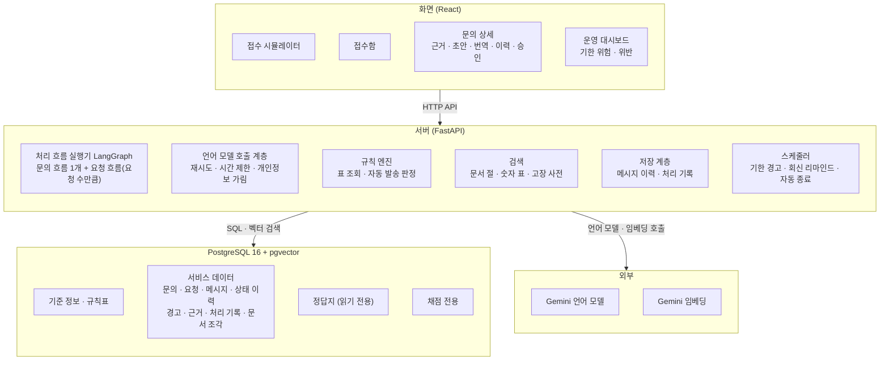
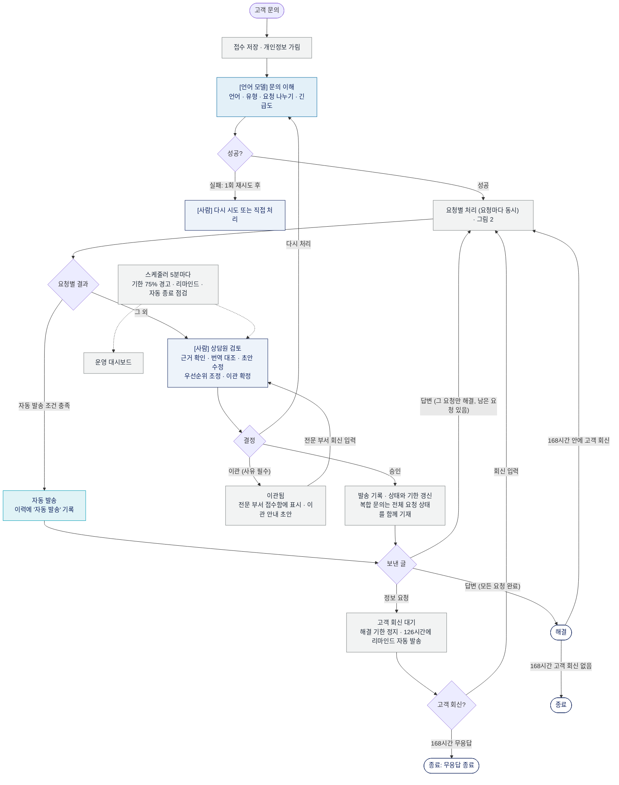
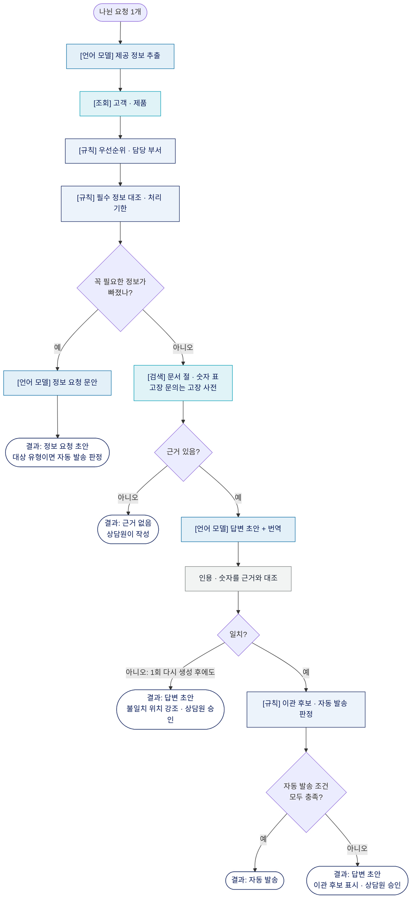

# 프로젝트 기획서 — C/S 자동화 에이전트

**Customer Service Automation Agent**

| 항목 | 내용 |
|---|---|
| 과정 | SKKU × LS AI CAMPUS 1기, 주제 1. 해외 고객향 C/S 대응 AI Agent 구축 (90H) |
| 서비스 이름 | C/S 자동화 에이전트 (Customer Service Automation Agent) |
| 팀 | 2조 — 나송주(AI), 박경빈(DB), 최민정(조장·FE), 홍예원(BE) |
| 작성일 / 버전 | 2026-10-13 / v1.4 (v1.3에 기능 요구사항 명세서 v1.2와 주제 1 마지막 회의 결정을 반영) |
| 근거 자료 | 학습 데이터 v1(문의 4,000건, 기준표 12종, 문서 107개), README.html, 추적표 9건, 팀공유_데이터분석_정리.md, 기술_스택.md |
| 함께 보는 문서 | 기능 요구사항 명세서 v1.2(MVP 기능 36개 + 추가 개발 6개), 기술 명세서, 도메인 용어집, 테이블 정의서, WBS |

---

## 한눈에 보기

**무엇을 만드나.** 해외 고객의 문의가 들어오는 순간 에이전트가 문의를 읽고, 규칙표로 우선순위·담당 부서·처리 기한을 정하고, 문서 근거가 붙은 답변 초안을 고객 언어로 만들어 둔다. 위험이 낮은 단순 정보 문의는 바로 답하고, 나머지는 상담원이 확인·수정·승인한다.

**왜 필요한가.** 문의 4,000건을 분석한 결과다.

| 문제 | 숫자 |
|---|---|
| 첫 답이 느리다 | 첫 응답까지 중앙값 8.4시간, 기한 위반 457건(11.4%) |
| 정보가 빠져 되묻는다 | 처리에 꼭 필요한 정보 누락 894건(22%), 되물은 뒤 고객 회신까지 평균 25.1시간 |
| 고객이 진행 상황을 몰라 다시 묻는다 | 재문의 1,482건(37%) |

**어떻게 푸나.** 원칙은 세 가지다. **읽기는 언어 모델, 결정은 규칙표, 확정은 사람.**

| 해법 | 내용 |
|---|---|
| 접수 즉시 초안 | 분류·우선순위·부서·기한·답변 초안을 접수 직후 준비 |
| 저위험 문의 자동 발송 | 사양·매뉴얼·인증 문의의 정보 요청과 답변은 합격 조건을 모두 통과하면 사람 승인 없이 발송 (과거 데이터 기준 대상 1,350건, 34%) |
| 빠진 정보 바로 요청 | 접수 단계에서 필요한 정보를 찾아 고객 언어로 요청 문안 작성 |
| 진행 안내와 기한 경고 | 상태가 바뀔 때 안내 초안, 정보 요청 뒤 126시간에 회신 요청 리마인드 자동 발송, 기한의 75%에서 경고, 운영 대시보드 |
| 고장·이관 지원 | 고장 사전으로 원인 후보를 제시하고 이관할 부서를 표시한다. 상담원이 이관을 확정하면 전문 부서 접수함으로 넘어간다 |

**언제까지.** 2026-10-14 기획서 제출, 2026-11-10 최종 발표·시연.

**어떻게 검증하나.** 정답이 있는 평가용 597건으로 채점한다. 규칙으로 정하는 항목(우선순위·부서·기한)은 100% 일치가 기준이고, 언어 모델이 읽는 항목(유형·긴급도 등)은 검증용 603건을 처음 채점한 뒤 기준을 확정한다.

---

## 1. 프로젝트 개요

### 1-1. 배경: 해외 고객 C/S 업무

산업용 전력·자동화 제품(변압기, 차단기, 인버터, PLC, HMI 등 23종)을 쓰는 해외 고객이 문의를 보낸다. 고객은 15개 언어를 쓰고, 문의는 5개 경로(이메일, 파트너 포털, 웹 양식, 전화, 채팅)로 들어온다. 전체의 44%가 영어가 아닌 언어다.

문의는 10개 유형으로 나뉜다.

| 구분 | 유형 | 건수 |
|---|---|---|
| 문서·표로 답이 끝나는 문의 | 기술 사양 600, 매뉴얼 400, 펌웨어 350, 인증·규격 350 | 1,700 |
| 판단이나 확정이 필요한 문의 | 견적 300, 납기 350, 보증 300, 설치 450 | 1,400 |
| 사고 처리 | 고장 550, 반품 350 | 900 |

상담원은 한 건마다 다음 일을 한다.

1. 본문을 읽고 유형과 긴급도를 판단한다.
2. 규칙표 네 종류(우선순위 7줄, 담당 부서 111줄, 필수 정보 110줄, 처리 기한 120줄)를 찾는다.
3. 영어 문서 107개에서 근거를 찾는다.
4. 고객 언어로 답을 쓴다.

처리 기한(SLA)은 두 가지다. **첫 응답 기한**은 접수부터 첫 답까지이고, **해결 기한**은 접수부터 해결까지다. 해결 기한은 고객 회신을 기다리는 동안 멈춘다. 기한은 고객 등급(PLATINUM / GOLD / STANDARD)과 우선순위(P1~P4)에 따라 달라진다.

이 프로젝트의 데이터는 LS ITC가 제공한 합성 데이터다. 수치는 실제 값이 아니라 경향으로 읽는다.

### 1-2. 프로젝트 목적

문의가 들어오는 순간 에이전트가 분류, 우선순위, 담당 부서, 처리 기한, 추가 정보 요청, 문서 기반 답변 초안을 먼저 만든다.

- 위험이 낮은 단순 정보 문의는 에이전트가 자체 검증을 통과한 답변을 바로 발송한다.
- 그 밖의 문의는 상담원이 확인·수정·승인한 뒤 발송한다.
- 반품 승인·거절, 견적 금액, 납기 확정은 사람이 한다.
- 답변에는 문서 근거와 표에서 조회한 값만 쓰고, 어디서 가져왔는지 남긴다.

---

## 2. 문제 정의

### 2-1. 현재 문제

| 순위 | 문제 | 데이터 근거 (문의 4,000건) | 원인 |
|---|---|---|---|
| 1 | 첫 응답이 느리다 | 첫 응답까지 중앙값 8.4시간, 평균 15.5시간. 첫 응답 기한 위반 457건(11.4%) | 읽기·분류·규칙 찾기·문서 검색·작문을 모두 사람이 한다 |
| 2 | 정보가 빠져 되묻는다 | 처리에 꼭 필요한 정보 누락 894건(22%), 추가 정보 요청 887건, 요청 뒤 고객 회신까지 평균 25.1시간, 무응답 종료 159건 | 어느 접수 경로도 필수 정보를 강제하지 않는다. 채팅·전화는 누락률이 40%를 넘는다 |
| 3 | 고객이 진행 상황을 몰라 다시 묻는다 | 재문의 1,482건(37%). 2회 이상 재문의한 335건 중 269건(80%)이 해결 기한 위반 | 첫 응답 뒤 해결까지 중간 안내가 없다 |

### 2-2. 함께 풀 문제

| 문제 | 데이터 근거 |
|---|---|
| 단순 정보 문의도 오래 걸린다 | 자동 발송 대상 유형(사양·매뉴얼·인증) 1,350건의 첫 응답 중앙값 15.2시간, 기한 위반 134건 |
| 이관된 건이 더 늦다 | 이관 685건의 해결 기한 위반율 16.2% (이관하지 않은 건 9.2%) |
| 기한 위반을 사후에만 안다 | 미해결 365건 중 이미 위반 141건, 위험 34건 |
| 한 문의에 요청이 둘이면 하나가 묻힌다 | 복합 문의 350건. 그중 295건은 두 요청의 담당 부서가 다르다 |
| 우선순위를 바꾼 이유가 남지 않는다 | 우선순위 조정 120건에 사유 기록 없음 |

### 2-3. 바뀌는 모습

| 단계 | 지금 | 도입 후 |
|---|---|---|
| 접수 | 상담원이 읽고 분류한다 | 에이전트가 언어·유형·긴급도를 읽고 요청을 나눈다 |
| 규칙 적용 | 규칙표 네 종류를 사람이 찾는다 | 규칙표 조회로 즉시 결정하고 적용한 규칙을 화면에 표시한다 |
| 정보 확인 | 처리 중에 빠진 정보를 발견한다 | 접수 직후 빠진 정보를 찾아 요청 문안을 만든다 |
| 답변 | 문서를 찾아 고객 언어로 직접 쓴다 | 근거가 붙은 초안이 준비된다. 저위험 문의는 자동 발송한다 |
| 진행 관리 | 기한 위반을 지난 뒤에 안다 | 기한의 75%에서 경고하고 대시보드에 모아 보여 준다 |
| 고객 안내 | 중간 안내가 없다 | 상태가 바뀔 때 안내 초안을 고객 언어로 만든다 |

---

## 3. 목표 및 기대효과

### 3-1. 주요 목표

| # | 목표 | 대응 문제 | 측정 방법 |
|---|---|---|---|
| G1 | 접수 즉시 분류·우선순위·부서·기한·답변 초안을 만든다. 상담원은 확인·수정·승인만 한다 | 1순위 | 접수부터 초안 생성까지 걸린 시간, 평가용 정답 일치율 |
| G2 | 사양·매뉴얼·인증 문의의 정보 요청과 답변은 합격 조건을 모두 통과하면 자동 발송한다 | 1순위 | 조건이 어긋났는데 자동 발송된 건수(0이어야 함), 표본 검수 |
| G3 | 접수 단계에서 꼭 필요한 정보의 누락을 찾아 고객 언어로 요청한다 | 2순위 | 누락 정보 일치율, 요청 문안 생성률 |
| G4 | 상태가 바뀔 때 진행 안내 초안을 고객 언어로 만든다. 발송은 상담원 승인 뒤. 단, 정보 요청 뒤 126시간 회신 요청 리마인드는 고정 문안으로 자동 발송한다 | 3순위 | 상태 변화마다 안내 초안 생성 여부 |
| G5 | 한 문의에 요청이 여럿이면 요청마다 나누어 처리하고, 준비된 요청부터 빠짐없이 답한다 | 함께 풀 문제 | 나눈 요청의 유형 일치율, 요청별 답변 포함 여부 |
| G6 | 두 가지 기한을 계산해 75% 시점에 경고하고, 위험·위반 문의를 대시보드에 모은다 | 함께 풀 문제 | 기한 상태 재현율, 경고 발생 기록 |
| G7 | 고장 문의는 고장 사전으로 원인 후보와 조치를 제시하고, 이관이 필요하면 대상 부서를 표시한다. 상담원이 이관을 확정하고 전문 부서 회신을 받아 처리를 이어 간다 | 함께 풀 문제 | 고장 550건·이관 685건의 처리 방향 재현율 |

### 3-2. 기대효과

| 대상 | 효과 |
|---|---|
| 상담원 | 읽기·분류·규칙 찾기·문서 검색·초안 작성이 줄고 확인·수정·승인이 남는다. 초안 옆에 한국어(또는 영어) 번역을 함께 보여 주므로 15개 언어를 몰라도 처리할 수 있다 |
| 고객 | 저위험 정보 문의는 접수 직후 답을 받는다(지금은 중앙값 15.2시간). 그 밖의 문의도 고객 언어로 빠른 첫 응답과 진행 안내를 받는다. 요청이 여럿이어도 모두 답을 받는다 |
| 관리자 | 기한 위험·위반 문의를 대시보드에서 미리 보고 개입한다 |
| 전문 부서 | 이관된 문의를 자기 부서 접수함에서 이관 사유·메모·근거·빠진 정보가 정리된 상태로 확인한다 |

효과의 크기는 합성 데이터 기준 추정이다. 실제 단축 시간은 시연과 채점 결과로 제시한다.

---

## 4. 대상 사용자

### 4-1. 사용자

| 순위 | 사용자 | 하는 일 | 쓰는 화면 | 얻는 것 |
|---|---|---|---|---|
| 1 | 상담원 (1차 상담과 전문 부서, 13개 부서) | 문의 확인, 초안 수정, 우선순위 조정, 승인·발송 | 접수함, 문의 상세 | 분류·배정·근거·초안이 준비된 상태에서 시작 |
| 2 | 관리자 (C/S 팀장) | 기한과 대기 문의 관리 | 운영 대시보드, 접수함 | 기한 위험·위반 문의 목록, 부서별 미해결 건수, 기한 상태별 건수 |
| 3 | 고객 (해외, 15개 언어) | 문의 접수, 추가 정보 회신 | 직접 쓰는 화면 없음 (접수 시뮬레이터가 대신함) | 고객 언어의 빠른 답변·정보 요청·진행 안내 |

로그인과 권한 관리는 범위에 없다. 화면 위에서 상담원 이름과 부서를 고른다.

### 4-2. 핵심 사용 시나리오

| 시나리오 | 흐름 | 예시 문의 |
|---|---|---|
| ⓐ 저위험 정보 문의 | 접수 → 사양 문의로 분류 → 근거 문서와 표 값 확인 → 합격 조건 통과 → 자동 발송 → 해결 | 변압기 사양 문의 |
| ⓑ 안전·설비 정지 | 접수 → 설비 정지로 판단 → 최우선(P1) → 첫 응답 기한 1시간 → 75% 시점에 경고가 접수함 맨 위와 대시보드에 표시 | CSV1-000017 (저압 차단기 과열, PLATINUM 고객) |
| ⓒ 필수 정보 누락 | 접수 → 빠진 정보(제품 일련번호) 발견 → 고객 언어 요청 문안 → 승인·발송 → 고객 회신 대기(해결 기한 정지, 126시간에 리마인드 자동 발송) → 회신 입력 → 답변 초안 → 승인·발송 | CSV1-003578 (이탈리아 고객) |
| ⓓ 복합 문의 | 접수 → 요청 2개로 나눔(펌웨어 + 매뉴얼) → 요청마다 따로 처리 → 매뉴얼 답변은 조건 통과 시 자동 발송, 펌웨어 답변은 상담원 승인 → 메일마다 전체 요청의 진행 상태를 함께 적음 | CSV1-000008 (아랍어) |
| ⓔ 고장 문의와 이관 | 접수 → 오류 코드로 고장 사전 조회 → 원인 후보와 조치 제시 → 현장 조치가 필요하면 이관 후보 부서를 화면에 표시 → 상담원이 이관 확정(사유 필수) → 고객에게 이관 안내 → 전문 부서 회신 입력 → 처리 중으로 돌아옴 | 추적표의 현장 서비스 이관 건 |
| ⓕ 사람의 조정 | 상담원이 우선순위를 P4에서 P3로 조정(사유 필수) → 기한이 72/168시간에서 24/120시간으로 다시 계산됨 → 초안 수정 → 승인 | CSV1-000031 |

---

## 5. 주요 기능 및 요구사항

### 5-1. 기능 구성

| 영역 | 기능 | 설명 |
|---|---|---|
| 접수 | 접수 시뮬레이터 | 이메일·채팅·전화·포털을 대신해 문의를 입력한다 |
| 접수 | 시연용 문의 불러오기 | 학습용 데이터의 문의를 불러와 처리한다 |
| 문의 이해 | 언어 식별 | 본문 언어와 답장 언어를 구분한다 (전화 메모는 영어, 답장은 고객 언어) |
| 문의 이해 | 유형 분류와 요청 나누기 | 10개 유형 중 고르고, 요청이 여럿이면 나눈다 |
| 문의 이해 | 긴급도 판단 | 안전, 설비 정지, 생산 영향, 시운전, 마감 임박 여부를 읽는다 |
| 문의 이해 | 제공 정보 추출 | 본문에서 제품명·일련번호·오류 코드 등 이미 준 정보를 뽑는다 |
| 규칙 적용 | 고객·제품 조회 | 고객 등급과 제품군을 표에서 찾는다 |
| 규칙 적용 | 우선순위·담당 부서 | 규칙표로 정한다. 표에 없으면 비우고 사람에게 넘긴다 |
| 규칙 적용 | 필수 정보 대조 | 필요한 정보와 받은 정보를 비교해 빠진 것을 찾는다 |
| 규칙 적용 | 처리 기한 설정 | 고객 등급·우선순위·유형으로 두 기한을 정한다 |
| 근거와 초안 | 문서 검색 | 해당 제품 문서, 정책 4종, 제품군 FAQ에서 근거 절을 찾는다 |
| 근거와 초안 | 숫자 조회 | 가격·납기·사양·펌웨어 버전은 표에서 조회한다. 펌웨어는 접수일 이전에 나온 것만 쓴다 |
| 근거와 초안 | 고장 진단 | 고장 사전(97종)에서 오류 코드·증상으로 원인 후보와 조치를 찾는다 |
| 근거와 초안 | 정보 요청 문안 | 빠진 정보를 고객 언어로 요청한다 |
| 근거와 초안 | 답변 초안 | 근거 안에서만 고객 언어로 쓴다. 인용과 숫자를 근거와 다시 대조한다 |
| 근거와 초안 | 번역 함께 표시 | 초안 옆에 한국어(또는 영어) 번역을 나란히 보여 준다 |
| 근거와 초안 | 진행 안내 | 상태가 바뀔 때 안내 초안을 만든다 |
| 근거와 초안 | 근거 표시 | 적용한 규칙, 인용한 문서와 절, 조회한 표 값을 화면에 보여 준다 |
| 발송 | 자동 발송 판정 | 5-2의 대상과 합격 조건을 모두 통과하면 사람 승인 없이 발송한다 |
| 발송 | 승인·발송 | 그 밖의 글은 상담원이 수정·승인한 뒤 발송한다 |
| 이관 | 이관 후보 표시 | 규칙표와 고장 사전을 근거로 이관할 부서를 화면에 표시한다 |
| 이관 | 이관 처리 | 상담원이 이관 부서와 사유를 정해 확정한다. 이관된 문의는 전문 부서 접수함에 보이고, 전문 부서 회신을 입력하면 처리 중으로 돌아온다 |
| 기한과 상태 | 상태 변화와 이력 | 허용된 상태 변화만 받고 모두 기록한다 |
| 기한과 상태 | 두 기한 계산과 75% 경고 | 첫 응답 기한과 해결 기한을 따로 계산한다 |
| 기한과 상태 | 우선순위 조정 | 사유를 반드시 적고, 기한을 다시 계산한다 |
| 기한과 상태 | 무응답 자동 종료 | 정보 요청 뒤 126시간에 회신 요청 리마인드를 자동 발송하고, 168시간 무응답이면 자동 종료한다. 최종 답변 뒤 168시간 동안 고객 회신이 없어도 종료한다 |
| 화면 | 접수함, 문의 상세 | 목록·정렬·필터, 근거·초안·이력·승인 |
| 화면 | 고객 회신 입력 | 고객이 보낸 추가 정보를 넣고 다시 처리한다 |
| 화면 | 운영 대시보드 | 기한 위험·위반 문의 목록, 부서별 미해결 건수, 기한 상태별 건수 |
| 기록 | 메시지 이력, 처리 기록 | 주고받은 글과 단계별 처리 결과를 남긴다 |
| 기록 | 개인정보 가림 | 이메일·전화번호를 저장 전과 언어 모델 호출 전에 가린다 |

기능은 기능 요구사항 명세서 v1.2의 MVP 기능 36개와 같다. 추가 개발 기능 6개는 6-2에 있다. 기능 번호와 담당은 9장과 부록 C에 있다.

### 5-2. 자동 발송 기준

자동 발송은 요청 단위로 판정한다. 언어 모델을 쓰지 않고 규칙으로만 판정한다.

**대상**

| 항목 | 기준 |
|---|---|
| 글의 종류 | 정보 요청 문안과 답변. 진행 안내는 대상이 아니다 (상담원 승인). 예외: 회신 요청 리마인드는 고정 문안이라 이 판정 없이 자동 발송한다 |
| 문의 유형 | 기술 사양, 매뉴얼, 인증·규격. 한 메일에 여러 요청의 답이 묶이면 모두 이 세 유형이어야 한다 |

**합격 조건 (모두 통과해야 발송)**

| # | 조건 |
|---|---|
| 1 | 초안의 인용이 근거 안에 있고, 숫자가 조회한 표 값과 같다 |
| 2 | 답변이면 처리에 꼭 필요한 정보가 빠지지 않았다 |
| 3 | 확인 표시(확신 낮음, 판정 실패, 근거 없음, 반품 사유 확인 필요 등)가 하나도 없다 |
| 4 | 긴급도가 안전·설비 정지가 아니다 |

하나라도 어긋나면 발송하지 않고 "자동 발송 보류: {이유}"를 표시해 상담원 승인으로 넘긴다.

과거 4,000건 중 대상 유형은 1,350건(34%)이다. 이 가운데 72건은 실제로 이관된 건인데(인증서 미보유 등), 이런 건은 근거가 없어 조건 3에서 걸러진다.

**사람이 반드시 승인하는 것**

- 펌웨어, 고장, 반품, 보증, 설치, 견적, 납기 문의의 글
- 진행 안내 (회신 요청 리마인드 제외)
- 반품 승인·거절, 견적 금액, 납기 확정이 담긴 모든 글

자동 발송한 글은 메시지 이력에 보낸 쪽을 "시스템"으로 남기고, 접수함과 문의 상세에 "자동 발송됨"을 표시한다. 자동 발송한 답변도 첫 응답으로 인정한다.

### 5-3. 복합 문의 처리

나눈 요청(명세서의 "하위 문의")은 각각 하나의 문의처럼 다룬다.

| 항목 | 방식 |
|---|---|
| 나누기 | 한 문의의 요청을 나눈다. 나누는 수에 상한을 두지 않는다 (데이터에서는 한 문의에 최대 2개) |
| 처리 | 요청마다 따로, 동시에 처리한다 (긴급도 → 정보 추출 → 규칙 → 근거 → 초안) |
| 상태·기한·담당 | 요청마다 따로 가진다. 접수함에는 요청마다 한 줄씩, 각자의 담당 부서 접수함에 보인다 |
| 대표 상태 | 문의 전체를 보여 줄 때는 끝나지 않은 요청 중 가장 급한 요청의 상태를 쓴다. 모두 끝나면 해결. 해결 뒤 168시간 동안 고객 회신이 없으면 종료 |
| 발송 | 준비된 요청부터 발송한다. 다른 요청을 기다리지 않는다. 동시에 준비되고 담당 부서가 같으면 한 메일에 묶을 수 있다 |
| 상태 목록 | 메일 끝에 전체 요청의 현재 상태를 고객 언어로 적는다 (예: 1번 문의: 이 메일로 답변, 2번 문의: 추가 정보 확인 중). 예상 완료 시각은 쓰지 않는다 |
| 승인 | 요청별로 5-2 기준을 적용한다. 예: 매뉴얼 답변은 자동 발송, 펌웨어 답변은 상담원 승인 |
| 해결 | 답변을 보낸 요청만 해결로 바뀐다 |
| 저장 | 발송 결과는 메시지 이력에 요청 순번과 함께 남긴다. 요청별 결과의 저장 위치와 구조는 DB 설계 산출물(테이블 정의서)에서 정한다 |

### 5-4. 견적·납기·반품 문의

| 문의 | 에이전트가 하는 일 | 사람이 하는 일 |
|---|---|---|
| 견적 | 제품·수량·정가·합계·표준 납기를 안내하는 초안을 만든다. 초안에 "정확한 견적(수량 할인 등)은 영업 담당이 별도로 안내한다"는 문장을 넣는다. 확정 견적은 담당 부서인 영업이 맡는다 | 초안 승인, 할인·수량 조건을 반영한 확정 견적 안내 |
| 납기 | 표준 납기를 안내한다. 확정 출하일은 쓰지 않는다 | 초안 승인, 납기 확정 |
| 반품 | 사유(제품 결함 / 고객 사정)를 규칙으로 구분해 담당 부서를 정하고, 정책 조항과 예상 처리 절차를 제시한다. 구분이 애매하면 "확인 필요"를 표시한다 | 승인·거절 결정 |

과거 견적 답변 246건 중 161건은 단가가 정가와 달랐다. 할인 규칙이 표에 없으므로 에이전트는 금액을 확정하지 않는다.

반품 사유 구분은 규칙으로 먼저 만들고 검증용 데이터에서 일치율을 잰다. 낮으면 언어 모델 판별을 도입한다.

### 5-5. 비기능 요구사항

| 구분 | 기준 | 상태 |
|---|---|---|
| 성능 | 언어 모델 호출 1회 30초, 요청 1개 120초, 문의 전체 180초 안에 끝나지 않으면 실패 처리 | 제안 |
| 성능 | 기한 경고·무응답 종료 점검 주기 5분 | 제안 |
| 안정성 | 언어 모델·검색 실패는 1회 재시도 뒤 사람에게 넘긴다. 한 요청이 실패해도 나머지는 계속한다 | 확정 |
| 안정성 | 다시 처리하면 새 실행으로 기록하고, 이미 발송한 글은 지우지 않는다 | 제안 |
| 개인정보 | 새로 들어오는 글은 저장 전과 언어 모델 호출 전에 이메일·전화번호를 가린다. 데이터에 있던 가림 처리는 유지한다 | 확정 |
| 기록 | 단계별 입력·출력 요약, 오류, 걸린 시간, 언어 모델 사용량을 남긴다 | 제안 |
| 품질 | 초안의 인용과 숫자는 코드로 근거와 대조한다. 확신도 0.6 미만이면 "확신 낮음"을 표시한다 | 확정 / 제안 |
| 데이터 분리 | 검증용·평가용 문의는 서비스 DB와 검색 색인에 넣지 않는다. 문의 제목은 유형이 드러나므로 입력에서 뺀다 | 확정 |

---

## 6. 프로젝트 범위

### 6-1. 포함 (MVP)

5-1의 기능 전체(명세서 v1.2의 MVP 기능 36개)가 MVP다. 기획서 v1.1과 비교해 다음이 MVP에 새로 들어왔다.

| 추가된 기능 | 이유 |
|---|---|
| 고장 진단, 이관 후보 표시, 이관 처리 | 고장 550건·이관 685건을 다루지 않으면 현업 문의의 큰 부분이 빠진다 |
| 운영 대시보드 | 기한 위험·위반 문의를 관리자가 미리 봐야 한다 |
| 자동 발송 판정 | 1순위 문제(느린 첫 응답)에 직접 대응한다 |
| 초안 옆 번역 표시 | 상담원이 고객 언어를 몰라도 초안을 검토할 수 있어야 한다 |
| 회신 요청 리마인드 | 정보 요청 뒤 무응답 종료(159건) 전에 한 번 더 묻는다 |

### 6-2. 추가 개발과 확장 (MVP 밖)

추가 개발은 명세서 v1.2 그룹 7에 요구사항이 있는 기능으로, MVP가 끝난 뒤 4단계(고도화·점검)에서 착수한다. 확장은 요구사항을 아직 쓰지 않은 기능이다.

| 구분 | 기능 | 넣으면 되는 것 |
|---|---|---|
| 추가 개발 | 평가 러너 (FR-042, Should) | 검증용·평가용 문의를 처리 흐름에 넣고 정답지와 항목별로 자동 채점한다 (10장의 채점을 돌리는 도구) |
| 추가 개발 | 상담원 수정·승인 기록 (FR-043, Could) | 상담원이 고친 값과 사유를 쌓아 운영 중 정답으로 쓴다 |
| 추가 개발 | 주간 품질 추이 (FR-044, Could) | 기간별 일치율을 운영 대시보드와 파일로 본다 |
| 추가 개발 | 실시간 자체 검사 경고 (FR-045, Could) | 정답 없이 할 수 있는 검사(코드값·인용·숫자)에 걸린 초안은 자동 발송하지 않는다 |
| 추가 개발 | few-shot 예시 자동 선택 (FR-046, Could) | 비슷한 과거 문의(학습용 + 사람이 검토해 채택한 기록)를 예시로 넣는다 |
| 추가 개발 | 유사 해결 사례 검색 (FR-019, Could) | 고장 계열 문의에 과거 해결 사례(800건 중 학습용)를 상담원 참고로 보여 준다. 고객에게 가는 글의 근거로는 쓰지 않는다 |
| 확장 | 반품 사유 언어 모델 판별 (FR-009) | 규칙 구분의 일치율이 낮을 때만 도입 |
| 확장 | 접수 경로별 입력 양식 (FR-002) | 웹 양식·포털에서 필수 정보 누락을 접수 단계에서 막음 |
| 확장 | 반품 승인·거절 예상 결과 제시 | 정책 조항을 근거로 예상 결과까지 안내 |

### 6-3. 제외

| 항목 | 이유 |
|---|---|
| 외부 시스템 연동 (메일·채팅·전화·고객지원 시스템) | 실제 연동 대상이 없다. 접수 시뮬레이터로 대신하고, 연결 지점은 서버의 접수·회신 API로 둔다 |
| 로그인·권한, 고객용 화면 | 시뮬레이터와 화면 위 상담원 선택으로 대신한다 |
| 반품 승인·거절, 견적 금액, 납기 확정의 자동 결정 | 사람이 결정한다 |
| 미등록 고객의 문의 | 고객 목록에 없는 고객은 접수를 거부한다. 신규 고객 등록은 범위 밖이다 |

### 6-4. LS ITC 제시 활용 방향 10가지와의 대응

| 활용 방향 | 이 프로젝트 |
|---|---|
| 다국어 입력 처리, 자동 분류, 문서 기반 답변 초안, 추가 정보 요청 자동화, 진행 안내 자동화, 이관 후보 탐지, 기한 위험 분석, 운영 대시보드 | 포함 (8개) |
| 유사 사례 검색 | 추가 개발 (1개, MVP 밖) |
| 고객지원 시스템 연계 API | 제외 (1개, 접수·회신 API로 연결 지점만 둠) |

---

## 7. 시스템 구성 및 기술 스택

### 7-1. 구성 요소

| 구성 요소 | 하는 일 |
|---|---|
| 접수 시뮬레이터 | 문의를 입력하고 처리 흐름을 시작한다 |
| 처리 흐름 (에이전트) | 문의를 한 번 읽어 요청을 나누고, 요청마다 읽기 → 규칙 → 근거 → 쓰기 순서로 처리한다 |
| 규칙·기준 정보 저장소 | 기준표 12종을 그대로 담는다. 우선순위·부서·필수 정보·기한은 여기서만 정한다 |
| 문서 저장소 | 문서 107개를 절 단위로 나눠 검색한다 |
| 상태·기한 계산 | 상태 이력에서 두 기한을 계산하고 주기적으로 점검해 경고한다 |
| 상담원 화면 | 접수함, 문의 상세, 운영 대시보드, 접수 시뮬레이터 |
| 기록 | 메시지 이력, 처리 기록 |

### 7-2. 역할 분담: 읽기는 언어 모델, 결정은 규칙, 확정은 사람

| 역할 | 하는 일 | 하지 않는 일 |
|---|---|---|
| 읽기 (언어 모델) | 유형 고르기, 요청 나누기, 긴급도 판단, 본문의 값 뽑기 | 우선순위·부서·기한을 정하지 않는다 |
| 결정 (규칙) | 표에서 우선순위·부서·필수 정보·기한 찾기, 자동 발송 조건 판정 | 언어 모델을 부르지 않는다. 표에 없으면 비우고 사람에게 넘긴다 |
| 찾기 (근거) | 문서 절 검색, 가격·납기·사양·펌웨어·고장 사전 조회 | 값을 만들어 내지 않는다 |
| 쓰기 (언어 모델) | 정보 요청 문안, 답변 초안, 진행 안내를 고객 언어로 쓰고 번역을 붙인다 | 근거 밖의 사실·숫자를 쓰지 않는다 |
| 확정 (사람) | 수정·승인·발송, 우선순위 조정, 반품·견적·납기 결정 | — |

근거가 없으면 초안을 만들지 않고 상담원에게 넘긴다.

### 7-3. 데이터

| 데이터 | 규모 | 용도 | 방침 |
|---|---|---|---|
| 문의 | 4,000건 | 학습용 2,800 = 서비스 이력·시연, 검증용 603 = 사전 점검, 평가용 597 = 최종 채점 | 검증용·평가용은 서비스 DB와 색인에 넣지 않는다 |
| 기준표 | 12종 (규칙표 4 + 기준 정보 8) | 우선순위·부서·필수 정보·기한 결정, 가격·사양·펌웨어 조회, 고장 진단 | 그대로 담고, 코드에 규칙을 직접 쓰지 않는다 |
| 문서 | 107개 (제품 92 + 정책 4 + FAQ 11, 영어) | 답변 근거 | 절 단위 색인, 제품별로 검색 범위 제한 |
| 고장 사전 | 97종 | 고장 진단, 이관 후보 | 오류 코드·증상으로 조회 |
| 해결 사례 | 800건 | 고장 진단 검증, 유사 사례 검색(추가 개발) | 평가용 문의에 연결된 사례는 서비스에서 쓰지 않는다 |

외부 호출은 언어 모델과 임베딩 API뿐이다.

### 7-4. 기술 스택

| 구분 | 선택 | 비고 |
|---|---|---|
| 백엔드 | Python, FastAPI, Pydantic | API와 처리 흐름 실행 |
| 에이전트 흐름 | LangGraph | 단계 순서 고정, 요청별 동시 실행 |
| DB | PostgreSQL 16 + pgvector | 기준표·서비스 데이터·이력·기록·문서 벡터 |
| 프런트엔드 | React, Vite, TypeScript | 화면 4개 |
| 언어 모델·임베딩 | Gemini | 15개 언어 품질과 비용 기준으로 선택. 호출부는 한 곳에 둔다 |
| 실행 환경 | Docker Compose | 팀원 모두 같은 명령으로 실행 |

### 7-5. 시스템 구조

- 화면은 서버 API만 부르고, 서버만 DB와 외부 API에 접근한다.
- 규칙 엔진은 언어 모델을 쓰지 않는다.
- 정답지는 서비스가 읽지 않는다. 시연용 문의 불러오기와 채점만 쓴다.

### 7-6. 처리 흐름

**그림 1. 문의 한 건의 흐름 (접수부터 종료까지)**

**그림 2. 요청 하나의 처리 (나뉜 요청마다)**

**예외 처리**

| 상황 | 처리 |
|---|---|
| 언어 모델 호출 실패·시간 초과 | 1회 재시도. 그래도 실패하면 문의 이해는 실패로 기록하고 상담원이 다시 시도한다. 정보 요청·진행 안내는 영어 고정 문구를 쓴다. 답변 초안은 만들지 않는다 |
| 근거 없음·검색 실패 | 초안을 만들지 않고 "근거 없음"을 표시한다. 상담원이 작성한다 |
| 규칙표에 맞는 줄 없음 | 값을 비우고 사람 확인을 표시한다 (부서는 1차 상담으로 표시) |
| 인용·숫자 불일치 | 1회 다시 생성한다. 그래도 다르면 위치를 강조해 상담원에게 넘긴다. 자동 발송하지 않는다 |
| 복합 문의 일부 실패 | 실패한 요청만 표시하고 나머지는 계속한다. 메일에는 "확인 후 별도 안내"로 적는다 |

---

## 8. 추진 일정

### 8-1. 외부 일정

| 날짜 | 일정 |
|---|---|
| 2026-10-13 | 현업 방문 |
| 2026-10-14 | 기획서 제출 (WBS 함께 제출) |
| 2026-10-15 | 화면 시안(가짜 응답으로 동작) 완성, 멘토링 질문 정리 |
| 2026-10-16~ | 멘토링 |
| 2026-10-26~27 | 현업 추가 방문 |
| 2026-11-10 | 최종 발표·시연 |

### 8-2. 단계별 계획

| 단계 | 기간 | 할 일 | 완료 기준 |
|---|---|---|---|
| 0. 킥오프 | 10-04~05 | 목표·역할·규칙 합의, 노션·GitHub 준비 | 완료 |
| 1. 분석·설계 | 10-06~14 | 데이터 분석, DB 설계, 추적표 9건, 기획서·명세서 | 기획서 제출 (10-14) |
| 2. 기반·화면 시안 | 10-12~15 | 개발 환경, 공통 인터페이스 합의, DB 생성·적재, 가짜 응답으로 화면 시안 | 4명 모두 같은 명령으로 실행됨. 화면 시안이 멘토링 전에 동작 |
| 3. MVP 개발 | 10-16~23 | 문의 이해 → 규칙 → 근거·초안 → 기한·상태(리마인드·자동 종료 포함) → 고장 진단·이관 후보·이관 처리 → 자동 발송 → 화면 연결 | 추적표 9건이 화면에서 재현됨 |
| 4. 고도화·점검 | 10-26~30 | 검증용 603건 채점, 성공 기준 확정, 프롬프트·규칙 개선, 자동 발송 조건 검증, 대시보드, 현업 피드백 반영, 추가 개발 착수(평가 러너부터, 6-2 순서) | 항목별 점수표, 개선 전후 비교 |
| 5. 통합·안정화 | 11-02~04 | 예외 처리, 통합 테스트, 배포 구성, 시연 연습 | 시나리오 6개가 3회 연속 실패 없이 동작 |
| 6. 발표 준비 | 11-05~09 | 평가용 597건 최종 채점(1회), 발표 자료, README, 발표 연습 2회 | 채점 결과표, 발표 자료 |
| 발표 | 11-10 | 최종 발표·시연 | — |

단계 3 이후의 날짜는 계획안이다. 세부 작업과 날짜는 WBS에서 관리하고, WBS가 확정되면 이 표를 맞춘다.

### 8-3. 단계별 역할

8-2의 단계마다 역할별로 하는 일이다. 최종 발표일(11-10) 기준이다.

| 단계 | 최민정 (조장·FE) | 나송주 (AI) | 박경빈 (DB) | 홍예원 (BE) |
|---|---|---|---|---|
| 2. 기반·화면 시안 (10-12~15) | 공통 인터페이스 합의 진행, 화면 뼈대, 가짜 응답으로 화면 시안 | 언어 모델·임베딩 모델 결정, 분류 출력 모양 제안 | 테이블 구조 보완(요청 = 문의), 기준표·정답지 적재, 문서 조각 저장 | 개발 환경, API 목록과 뼈대, 가짜 응답 API |
| 3. MVP 개발 (10-16~23) | 접수 시뮬레이터, 접수함, 문의 상세, 근거·번역 표시, 승인·회신·이관 화면, 실제 API 연결 | 문의 이해(언어·유형·요청 나누기·긴급도), 정보 추출, 문서 검색, 정보 요청 문안, 답변 초안과 자체 대조, 진행 안내(회신 리마인드 문안 포함), 번역 | 고객·제품·숫자 조회, 필수 정보 확인, 기한 설정·계산·경고, 고장 진단, 메시지 이력·처리 기록·개인정보 가림 | 접수 API, 우선순위·담당 부서, 상태 관리, 우선순위 조정, 이관 후보, 이관 처리, 복합 문의 답변 구성, 자동 발송 판정, 승인·발송, 고객 회신, 처리 흐름 연결, 추적표 9건 재현 |
| 4. 고도화·점검 (10-26~30) | 운영 대시보드(주간 품질 추이 영역 포함), 화면 다듬기, 시나리오 화면 확인 | 분류·긴급도·추출 프롬프트 개선, 검색·다국어 초안 개선, 추가 개발(자체 검사 경고, few-shot 예시, 유사 사례 검색) | 평가 러너(채점 배치), 검증용 603건 채점, 규칙·기한 불일치 분석, 개선 전후 비교표, 추가 개발(상담원 수정 기록, 주간 품질 추이) | 대시보드 집계 API, 예외 처리, 시나리오 흐름 점검 |
| 5. 통합·안정화 (11-02~04) | 통합 테스트 진행, 시연 연습 | 다국어 초안 검수 마무리 | 처리 기록 점검, 버그 수정 | 예외 처리 마무리, 배포 구성, 새 환경 실행 확인 |
| 6. 발표 준비 (11-05~09) | 발표 자료 취합, 발표 연습 진행 | 발표 자료(언어 모델·검색), README | 평가용 597건 최종 채점, 발표 자료(데이터·채점) | 발표 자료(구조·처리 흐름), README |

### 8-4. 마일스톤

| 마일스톤 | 날짜 | 확인할 것 |
|---|---|---|
| M1 기획서 제출 | 10-14 | 기획서, WBS |
| M2 화면 시안 | 10-15 | 공통 인터페이스 합의, 가짜 응답으로 화면 동작 |
| M3 MVP 완료 | 10-23 | 추적표 9건 화면 재현 |
| M4 현업 시연 | 10-26~27 | 현업 추가 방문에서 MVP 시연, 피드백 수집 |
| M5 기능 동결 | 10-30 | 검증용 점수표, 성공 기준 확정. 이후 새 기능 없음 (끝나지 않은 추가 개발은 넣지 않는다) |
| M6 시연 준비 | 11-04 | 통합 테스트 통과, 새 환경에서 README대로 실행 |
| M7 최종 발표 | 11-10 | 채점 결과표, 발표 자료, 시연 |

### 8-5. 늦어질 때 미루는 순서

1. 추가 개발과 확장 기능 전체 (평가 러너는 채점 배치로 대신한다)
2. 운영 대시보드의 부서별 집계 (기한 위험·위반 목록은 유지)
3. 접수함 시연용 미해결 데이터 재생(학습용 미해결 243건) (시연은 추적표 9건과 시나리오로 한다)
4. 다국어 초안 검수는 언어당 1건을 먼저 하고 나머지는 통합 단계로 넘긴다

---

## 9. 팀 구성 및 역할

역할은 기술 층(화면·서버·언어 모델·데이터) 단위로 나눈다. 기능 요구사항 명세서 v1.2의 기능마다 완료 기준을 책임지는 주담당을 두고, 다른 층에 걸친 부분은 협업으로 적는다.

### 9-1. 역할

| 팀원 | 역할 | 맡는 일 | 주담당 기능 수 |
|---|---|---|---|
| 나송주 | AI (언어 모델·검색) | 문의 이해(언어·유형·요청 나누기·긴급도), 정보 추출, 문서 근거 검색, 정보 요청 문안, 답변 초안과 자체 대조, 진행 안내, 번역 | 10 |
| 박경빈 | DB (표·조회·기록) | 테이블 구조와 데이터 적재, 고객·제품·숫자 조회, 필수 정보 확인, 기한 설정·계산·경고, 고장 진단, 메시지 이력·처리 기록·개인정보 가림, 채점 | 10 |
| 최민정 | 조장, FE (화면) | 전체 일정과 결정 기록, 접수 시뮬레이터, 접수함, 문의 상세, 근거 표시, 운영 대시보드 | 6 |
| 홍예원 | BE (서버 API·규칙·처리 흐름) | 서버 API, 우선순위·담당 부서 판정, 상태 관리, 우선순위 조정, 이관 후보 표시, 이관 처리, 복합 문의 답변 구성, 자동 발송 판정, 승인·발송, 고객 회신, 처리 흐름 연결 | 10 |

AI 담당의 기능 수가 많지만 언어·유형·요청 나누기·긴급도는 언어 모델 호출 한 번으로 묶인다. 실제 작업 덩어리는 분류, 추출, 검색, 초안의 네 개다.

### 9-2. 기능별 담당

| 영역 | 기능 | 주담당 | 협업 |
|---|---|---|---|
| 접수 | 문의 접수(접수 시뮬레이터) | 최민정 | 홍예원(접수 API), 박경빈(저장) |
| 접수 | 시연용 문의 불러오기 | 최민정 | 홍예원(조회 API) |
| 문의 이해 | 언어 식별 | 나송주 | |
| 문의 이해 | 문의 유형 분류 | 나송주 | |
| 문의 이해 | 요청 나누기(복합 문의) | 나송주 | 홍예원(요청별 흐름 생성) |
| 문의 이해 | 긴급도 판단 | 나송주 | |
| 문의 이해 | 제공 정보 추출 | 나송주 | |
| 규칙 적용 | 고객·제품 조회 | 박경빈 | |
| 규칙 적용 | 우선순위 계산 | 홍예원 | 박경빈(규칙표 조회) |
| 규칙 적용 | 담당 부서 배정 | 홍예원 | 박경빈(규칙표 조회) |
| 규칙 적용 | 필수 정보 확인 | 박경빈 | 나송주(추출 결과) |
| 규칙 적용 | 처리 기한 설정 | 박경빈 | |
| 근거와 초안 | 정보 요청 문안 | 나송주 | |
| 근거와 초안 | 문서 근거 검색 | 나송주 | 박경빈(문서 조각 저장·색인) |
| 근거와 초안 | 숫자 조회(가격·납기·사양·펌웨어) | 박경빈 | |
| 근거와 초안 | 고장 진단 | 박경빈 | 나송주(증상 검색) |
| 근거와 초안 | 이관 후보 표시 | 홍예원 | |
| 근거와 초안 | 이관 처리 | 홍예원 | 최민정(이관 버튼·회신 입력 창), 박경빈(이관 기록) |
| 근거와 초안 | 답변 초안(자체 대조 포함) | 나송주 | |
| 근거와 초안 | 복합 문의 답변 구성 | 홍예원 | 나송주(문안) |
| 근거와 초안 | 진행 안내 | 나송주 | 홍예원(126시간 리마인드 주기 점검) |
| 근거와 초안 | 근거 표시 | 최민정 | 홍예원(근거 묶음 API) |
| 근거와 초안 | 초안 번역 표시 | 나송주 | 최민정(초안 옆 표시) |
| 기한과 상태 | 상태 관리와 변경 이력 | 홍예원 | 박경빈(상태 이력 표) |
| 기한과 상태 | 기한 경과·상태 계산 | 박경빈 | |
| 기한과 상태 | 기한 위험 경고(75%) | 박경빈 | 홍예원(주기 점검 실행) |
| 기한과 상태 | 우선순위 조정과 기한 재계산 | 홍예원 | 최민정(조정 버튼·사유 입력) |
| 화면과 발송 | 접수함 | 최민정 | 홍예원(목록 API) |
| 화면과 발송 | 문의 상세 | 최민정 | 홍예원(상세 API) |
| 화면과 발송 | 자동 발송 판정 | 홍예원 | 나송주(자체 대조 결과) |
| 화면과 발송 | 초안 수정·승인·발송 | 홍예원 | 최민정(편집기·승인 버튼) |
| 화면과 발송 | 고객 회신 입력 | 홍예원 | 최민정(회신 입력 창) |
| 화면과 발송 | 운영 대시보드 | 최민정 | 박경빈(집계 조회) |
| 기록 | 메시지 이력 저장 | 박경빈 | |
| 기록 | 처리 기록 | 박경빈 | 홍예원(흐름에서 기록 호출) |
| 기록 | 개인정보 가림 유지 | 박경빈 | |

**추가 개발 담당**

| 기능 | 주담당 | 협업 |
|---|---|---|
| 평가 러너 (FR-042) | 박경빈 | 홍예원(처리 흐름 일괄 실행) |
| 상담원 수정·승인 기록 (FR-043) | 박경빈 | 최민정(검토 상태 화면) |
| 주간 품질 추이 (FR-044) | 박경빈 | 최민정(대시보드 추이 영역) |
| 실시간 자체 검사 경고 (FR-045) | 나송주 | 홍예원(자동 발송 판정 연결) |
| few-shot 예시 자동 선택 (FR-046) | 나송주 | 박경빈(예시 후보 조회) |
| 유사 해결 사례 검색 (FR-019) | 나송주 | 박경빈(해결 사례 색인) |

기능 번호는 부록 C에 있다.

### 9-3. 공통 작업

| 작업 | 담당 |
|---|---|
| 공통 인터페이스 합의 진행, PR 검토, 결정 기록, 시연·발표 연습 진행 | 최민정 |
| 언어 모델·임베딩 모델 결정, 다국어 초안 검수 | 나송주 |
| 테이블 구조 보완(요청 = 문의 구조, 메시지·처리 기록 표), 기준표·정답지 적재, 채점 | 박경빈 |
| 개발 환경, API 뼈대, 처리 흐름 연결, 예외 처리, 배포 구성 | 홍예원 |
| 발표 자료, README | 각자 맡은 부분 |

### 9-4. 서로 기다리는 지점

| 누가 → 누구에게 | 무엇을 | 늦으면 |
|---|---|---|
| 전원 | 상태 객체·API·언어 모델 출력 모양 합의 | 4명이 다른 모양으로 개발한다 |
| 박경빈 → 전원 | 테이블 구조(요청 = 문의) | 상태 처리와 요청 나누기 결과 저장이 막힌다 |
| 나송주 → 박경빈 | 모델 결정(임베딩 크기) | 분류와 색인을 시작할 수 없다 |
| 홍예원 → 최민정 | API 모양(가짜 응답) | 화면을 실제 데이터 없이 진행할 수 없다 |
| 나송주 → 박경빈 | 정보 추출 결과 | 필수 정보 확인을 정답 입력으로만 시험한다 |
| 나송주 → 홍예원 | 자체 대조 결과 | 자동 발송 판정을 시험할 수 없다 |
| 전원 → 홍예원 | 각 단계 완성 | 추적표 9건 재현과 채점이 밀린다 |

단계별로 누가 무엇을 하는지는 8-3에 있다. 작업 시간과 일자별 일정은 WBS에서 관리한다.

---

## 10. 검증 방법 및 완료 기준

### 10-1. 채점 방법

- 평가용 597건은 최종 채점에 한 번만 쓴다. 개발 중 점검은 검증용 603건으로 한다.
- 채점은 평가 러너(FR-042)로 자동화한다. 평가 러너가 늦으면 같은 항목을 채점 배치로 돌린다.
- 문의 제목은 입력에서 뺀다 (제목만으로 유형을 알 수 있다).
- 다음은 해당 항목 채점에서 빼고 따로 표시한다.
  - 펌웨어 출시일과 접수일이 맞지 않는 57건 (펌웨어 버전 항목)
  - 시간 기록에 이상이 있는 10건 (경과 시간 항목만 제외, 상태 값은 채점) (D26 확정)
  - 정답이 없는 항목 (진행 안내, 자동 발송 등)

### 10-2. 성공 기준

**규칙으로 정하는 항목: 100% 일치가 기준이다.**

| 항목 | 기준 |
|---|---|
| 우선순위 규칙 | 100% 일치 (정답 입력 기준) |
| 담당 부서 | 100% 일치 (분류와 반품 사유 구분이 맞은 건 기준) |
| 기한 상태 재현 | 첫 응답·해결 상태 100%, 경과 시간 오차 0.1시간 이내 |
| 숫자 (가격·납기·사양·버전) | 초안의 숫자가 표 값과 100% 일치 |

**언어 모델이 읽는 항목: 아래는 잠정 목표다. 검증용 603건을 처음 채점한 뒤 확정한다.**

| 항목 | 잠정 목표 |
|---|---|
| 문의 유형 | 일치율 95% 이상 |
| 긴급도 | 일치율 90% 이상 |
| 꼭 필요한 정보 누락 | 일치율 90% 이상 |
| 근거 문서 | 검색 상위 5개 안에 포함 85% 이상 |
| 복합 문의 유형 | 유형 묶음 일치율 85% 이상 (순서 무관) |

**따로 보고하는 항목**

| 항목 | 방법 |
|---|---|
| 안전·설비 정지·최우선(P1) 문의 | 평가용에는 안전 2건, 설비 정지 24건, P1 15건뿐이라 비율이 불안정하다. 전체 데이터에서 놓친 건수(재현율)를 따로 보고한다. 목표는 안전 문의를 하나도 놓치지 않는 것이다 |
| 전체 일치율 | 한 문의에서 유형·긴급도·우선순위·부서·누락 정보가 모두 맞은 비율을 함께 보고한다 |
| 자동 발송 | 합격 조건이 하나라도 어긋난 초안이 자동 발송된 건수 0. 검증용 표본을 사람이 검수해 "막았어야 할 건"의 수를 보고한다 |
| 고장 진단·이관 | 고장 550건·이관 685건의 처리 방향 재현율을 보고한다 (기준은 첫 채점 뒤 확정) |
| 접수부터 초안까지 걸린 시간 | 참고 지표로 측정한다 |

### 10-3. 완료 기준

| 구분 | 기준 |
|---|---|
| 시연 | 추적표 9건을 불러오면 분류부터 기한까지의 결과가 추적표와 같다 |
| 시연 | 시나리오 6개(4-2의 ⓐ~ⓕ)가 화면에서 끊김 없이 끝까지 동작한다 |
| 설명 가능성 | 화면에 "왜 이 결과인가"(적용 규칙, 인용 문서와 절, 조회한 표 값)가 표시된다 |
| 정확성 | 답변 초안에 문서에 없는 사실이나 표와 다른 숫자가 없다 |
| 실행 | 새 환경에서 README 순서대로 실행해 화면이 뜬다 |
| 산출물 | 기획서, 기능 요구사항 명세서, 기술 명세서, 테이블 정의서, WBS, 소스 코드, 채점 결과표, 발표 자료 |

### 10-4. 위험과 대응

| 구분 | 위험 | 대응 |
|---|---|---|
| 데이터 | 합성 데이터라 문장이 틀에 맞춰져 있다. 분류 점수가 실제보다 높게 나온다 | 제목을 입력에서 빼고, 점수는 경향으로 설명한다. 언어별로 표본을 검수한다 |
| 데이터 | 펌웨어 시점 모순 57건, 시간 기록 이상 10건 | 채점에서 제외 표시한다. 의도된 것인지 멘토에게 문의 중이다 |
| 데이터 | 첫 응답 본문·재문의 내용·대화 이력이 없다 | 진행 안내는 생성·발송 기록으로 확인한다. 메시지 이력은 서비스에서 새로 쌓는다 |
| 데이터 | 반품 사유, 견적 할인, 납기 가산 규칙이 표에 없다 | 반품은 규칙 구분과 "확인 필요" 표시, 금액·납기는 참고값(정가·표준 납기)만 안내하고, 확정 견적은 담당 부서인 영업이 맡는다 |
| 기술 | 자동 발송이 틀린 답을 내보낸다 | 대상을 세 유형으로 좁히고 합격 조건 4개를 모두 통과할 때만 발송한다. 인용·숫자를 코드로 대조한다. 판정 결과를 처리 기록에 남기고 사후 확인한다 |
| 기술 | 15개 언어 초안의 품질, 영어 문서 검색과의 언어 차이 | 영어 검색문으로 시작하고 검증용 데이터에서 다국어 임베딩과 비교한다. 초안 옆에 번역을 붙여 상담원이 검토한다 |
| 기술 | 언어 모델의 비용·지연, 같은 입력에 답이 조금씩 다름 | 규칙 단계는 언어 모델 없이 처리한다. 시간 제한과 1회 재시도를 둔다. 시연 문의는 미리 확인한다 |
| 기술 | 복합 문의는 요청마다 상태·기한을 따로 가져 구조가 복잡하다 | DB 설계에서 "요청 = 문의" 구조를 먼저 확정하고, 상태 처리와 저장을 그 뒤에 맞춘다 |
| 일정 | MVP 범위가 기획서 v1.1보다 넓어졌다 (고장 진단·이관 후보·이관 처리·대시보드·자동 발송·번역 표시·회신 리마인드) | 발표일이 11-10으로 확정되어 개발 기간이 늘었다. 10-30에 기능을 동결하고, 늦어지면 8-5 순서로 미룬다 |
| 일정 | 한 기능이 여러 역할에 걸쳐 서로 기다리는 지점이 많다 | 첫날 상태 객체·API·언어 모델 출력 모양을 합의한다. 화면은 가짜 응답으로 먼저 만든다. 이후 변경은 PR로만 한다 |

---

## 부록 A. 결정 기록

결정 번호는 기능 요구사항 명세서 v1.2와 같다. 기술 명세서의 결정 번호는 이 목록과 따로 매긴다. "변경"은 팀 논의(기획서 제출 전 논의 안건, 기획서 v1.1 논의)에서 바뀐 것이다.

| 번호 | 결정 내용 | 상태 |
|---|---|---|
| D1 | 최종 발표일은 2026-11-10. 일정은 8장 기준 | 확정 (변경) |
| D2 | 진행 안내는 정답이 없으므로 생성·발송 기록으로 확인하고, 메시지 표(ticket_message)로 관리한다 | 확정 (변경) |
| D3 | 펌웨어는 접수 시점 버전 규칙으로 구현한다. 모순 57건은 정답지로 채점할 때 제외한다 | 확정 (변경) |
| D4 | 반품 승인·거절은 판정하지 않고 정책 조항과 처리 절차를 제시한다. 예상 결과 제시는 여유가 있을 때 확장한다 | 확정 |
| D5 | 교체 납기 등 납기 문의는 표준 납기만 안내하고 확정 출하일은 쓰지 않는다 | 확정 |
| D6 | 운영 대시보드를 포함한다. 기한 위험·위반 문의 목록을 표시한다 | 확정 (변경) |
| D7 | 진행 안내는 상태가 바뀔 때 초안을 만들고 상담원이 승인해 발송한다. 자동 발송 대상이 아니다. 회신 요청 리마인드만 예외(D29) | 확정 |
| D8 | 언어 모델과 임베딩은 Gemini를 쓴다 | 확정 (변경) |
| D9 | 규칙 항목은 100%, 언어 모델 항목은 잠정 목표로 두고 검증용 603건 첫 채점 뒤 확정한다. 안전·P1 재현율과 전체 일치율을 따로 보고한다 | 확정 (변경) |
| D10 | 고장 진단, 이관 후보 표시, 이관 처리를 MVP로 개발한다 | 확정 (변경, 2026-10-12) |
| D11 | 시연의 "추적표 9건 재현"은 분류부터 기한까지의 결과 재현이다 | 확정 |
| D13 | 반품 사유 구분은 규칙과 "확인 필요" 표시로 먼저 개발한다. 검증용 일치율이 낮으면 언어 모델 판별을 도입한다 | 확정 (변경) |
| D14 | 견적은 정가·표준 납기만 안내하고, 초안에 "정확한 견적은 영업 담당이 별도로 안내한다"는 문장을 넣는다. 확정 견적은 담당 부서인 영업이 맡는다. 숫자 채점은 표 값 일치로 한다 | 확정 |
| D15 | 복합 문의는 요청별로 따로 처리하고, 준비된 요청부터 발송한다. 메일 끝에 전체 요청의 상태 목록을 적는다 | 확정 |
| D16 | 나눈 요청은 각각 하나의 문의처럼 상태·기한·담당 부서를 가진다 | 확정 |
| D17 | 요청별 결과의 저장 위치와 구조는 DB 설계 산출물(테이블 정의서)에서 정한다 | 확정 (2026-10-12) |
| D18 | 한 문의의 요청 수에 상한을 두지 않는다 | 확정 (2026-10-12) |
| D19 | 시간 기록 이상 10건은 경과 시간 채점에서 제외하고 상태 값은 채점한다 | 확정 (변경) |
| D20 | 최종 답변 발송 = 해결. 해결 뒤 168시간 동안 고객 회신이 없으면 시스템이 종료한다(종료 버튼 없음). 그 안에 회신이 오면 다시 처리 중. 기한은 해결 시각 기준 | 확정 (2026-10-12) |
| D21 | 첫 응답은 답변과 정보 요청만 인정한다 (접수 확인 안내는 제외). 자동 발송한 글도 포함한다 | 확정 |
| D22 | 정보 요청 뒤 168시간 무응답이면 자동 종료한다. LS ITC에는 확인 질문만 한다 | 확정 (2026-10-12) |
| D23 | 로그인 없이 화면 위에서 상담원 이름·부서를 고른다 | 확정 |
| D24 | 사양·매뉴얼·인증 문의의 정보 요청과 답변은 합격 조건(5-2)을 모두 통과하면 자동 발송한다 | 확정 |
| D25 | 고객 목록에 없는 고객의 문의는 접수를 거부한다 | 확정 (2026-10-12) |
| D26 | 채점에서 시간 기록 이상 10건과 펌웨어 모순 57건을 제외 표시한다 | 확정 (2026-10-12) |
| D27 | few-shot 예시는 학습용 문의와 사람이 검토해 채택한 상담원 기록만 쓴다 | 확정 (2026-10-12) |
| D28 | 주간 품질 추이는 운영 대시보드에 보이고 파일로도 내려받는다 | 확정 (2026-10-12) |
| D29 | 정보 요청 뒤 126시간(168시간의 75%)에 고정 문안 회신 요청 리마인드를 자동 발송한다. 문의당 한 번, 상태는 바뀌지 않는다 | 확정 (2026-10-12) |
| — | 초안 옆에 한국어(또는 영어) 번역을 함께 표시한다. 서비스 이름은 "C/S 자동화 에이전트", 영어 부제는 "Customer Service Automation Agent", 팀 이름은 "2조" | 확정 |

D12는 전제가 잘못되어 철회했다(결번).

**확인 중인 사항**

| 대상 | 내용 |
|---|---|
| 멘토 | 펌웨어 시점 모순 57건과 시간 기록 이상 10건이 의도된 것인지 |
| 현업 담당자 | 자동 발송 허용 범위, 견적·납기 안내 방식 등 현업 질문 6개 |

## 부록 B. 용어와 데이터 컬럼 대응

| 본문 표현 | 데이터 컬럼·값 |
|---|---|
| 문의 유형 | category_code (TECH_SPEC, MANUAL, FW_UPDATE, COMPLIANCE, QUOTE, ORDER_LEAD, WARRANTY, INSTALL, DEFECT, RETURN) |
| 복합 문의의 보조 유형 | secondary_category |
| 요청 (나눈 문의) | 명세서의 "하위 문의" |
| 긴급도 | urgency_flag (SAFETY, SITE_DOWN, PROD_IMPACT, COMMISSION, DEADLINE, NONE) |
| 우선순위, 우선순위 규칙 | priority, priority_rule_id (priority_rules.csv) |
| 담당 부서, 부서 규칙 | assigned_dept, routing_rule_id (routing_rules.csv) |
| 꼭 필요한 정보 누락 | missing_blocking_info (required_info.csv) |
| 첫 응답까지 걸린 시간 | first_response_hours |
| 고객 회신까지 걸린 시간 | customer_wait_hours |
| 재문의 횟수 | customer_followups |
| 첫 응답 기한·해결 기한 | sla_first_response_target_h, sla_resolution_target_h (sla_policy.csv) |
| 기한 상태 (준수 / 위험 / 위반) | sla_first_response_status, sla_resolution_status (MET / AT_RISK / BREACHED) |
| 고객 회신 대기 | status = WAITING_CUSTOMER |
| 무응답 종료 | status = CLOSED_NO_RESPONSE |
| 해결 / 종료 | status = RESOLVED / CLOSED |
| 이관됨 | status = ESCALATED |
| 이관 부서, 이관 사유 | escalated_to, escalation_reason |
| 처리 방향 | expected_action, final_action |
| 근거 문서와 절 | reference_doc_id, reference_section |
| 고장 사전 | fault_catalog.csv |
| 해결 사례 | resolution_cases.csv |
| 학습용 / 검증용 / 평가용 | data_split = train / valid / test |
| 1차 상담 | GCS_L1 |

## 부록 C. 기능 번호 대응

기능 요구사항 명세서 v1.2의 MVP 기능 36개와 이 문서의 대응이다.

| 영역 | 기능 번호 | 기능 |
|---|---|---|
| 접수와 문의 이해 | FR-001, 003, 004, 005, 006, 007, 008 | 문의 접수, 시연용 문의 불러오기, 언어 식별, 유형 분류, 요청 나누기, 긴급도, 제공 정보 추출 |
| 규칙 적용 | FR-010, 011, 012, 013, 014 | 고객·제품 조회, 우선순위, 담당 부서, 필수 정보 확인, 처리 기한 설정 |
| 근거와 초안 | FR-015, 016, 017, 018, 020, 021, 022, 023, 024, 039 | 정보 요청 문안, 문서 근거 검색, 숫자 조회, 고장 진단, 이관 후보 표시, 답변 초안, 복합 문의 답변 구성, 진행 안내, 근거 표시, 초안 번역 표시 |
| 기한과 상태 | FR-025, 026, 027, 028 | 상태 관리, 기한 계산, 기한 위험 경고, 우선순위 조정 |
| 화면과 발송 | FR-029, 030, 031, 032, 033, 034, 041 | 접수함, 문의 상세, 초안 수정·승인·발송, 고객 회신 입력, 이관 처리, 운영 대시보드, 자동 발송 판정 |
| 기록 | FR-035, 036, 038 | 메시지 이력, 처리 기록, 개인정보 가림 |

**MVP에 없는 기능**

| 기능 번호 | 기능 | 상태 |
|---|---|---|
| FR-019 | 유사 해결 사례 검색 | 추가 개발 |
| FR-042 | 평가 러너 | 추가 개발 |
| FR-043 | 상담원 수정·승인 기록 | 추가 개발 |
| FR-044 | 주간 품질 추이 | 추가 개발 |
| FR-045 | 실시간 자체 검사 경고 | 추가 개발 |
| FR-046 | few-shot 예시 자동 선택 | 추가 개발 |
| FR-002 | 접수 경로별 입력 양식 | 확장 |
| FR-009 | 반품 사유 언어 모델 판별 | 확장 (규칙 일치율이 낮을 때) |
| FR-037 | 외부 연계 창구 | 제외 |

