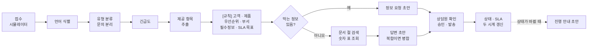
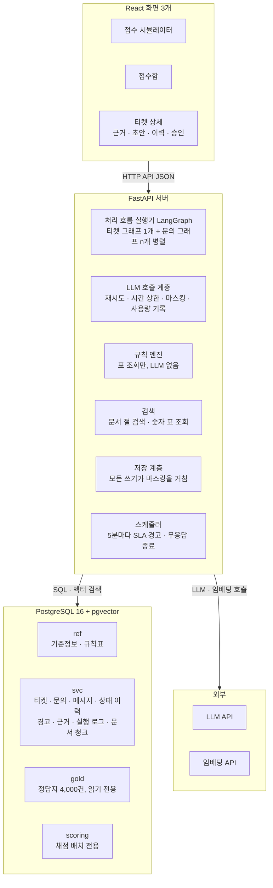
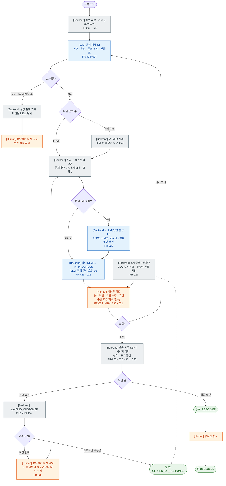
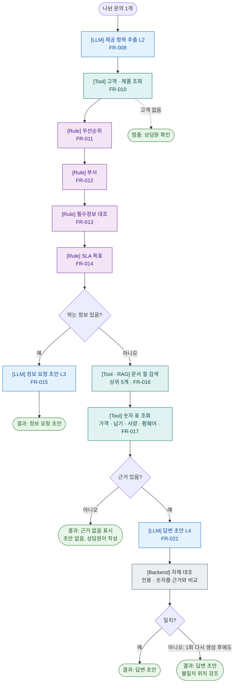

# 프로젝트 기획서 v1.1

결과: 해결 중
구분: 기획
담당자: mj choi
마감일: 2026년 10월 14일
버전: v1.1
상태: 검토 중
생성일: 2026/10/10
제출 대상: 강사·멘토
종류: 산출물
파일과 미디어: %ED%94%84%EB%A1%9C%EC%A0%9D%ED%8A%B8%20%EA%B8%B0%ED%9A%8D%EC%84%9C%20v1%201/%E1%84%91%E1%85%B3%E1%84%85%E1%85%A9%E1%84%8C%E1%85%A6%E1%86%A8%E1%84%90%E1%85%B3_%E1%84%80%E1%85%B5%E1%84%92%E1%85%AC%E1%86%A8%E1%84%89%E1%85%A5_v1.1.md, %ED%94%84%EB%A1%9C%EC%A0%9D%ED%8A%B8%20%EA%B8%B0%ED%9A%8D%EC%84%9C%20v1%201/%E1%84%80%E1%85%B5%E1%84%92%E1%85%AC%E1%86%A8%E1%84%89%E1%85%A5_v1.1_%E1%84%87%E1%85%A7%E1%86%AB%E1%84%80%E1%85%A7%E1%86%BC%E1%84%82%E1%85%A2%E1%84%8B%E1%85%A7%E1%86%A8.md, %ED%94%84%EB%A1%9C%EC%A0%9D%ED%8A%B8%20%EA%B8%B0%ED%9A%8D%EC%84%9C%20v1%201/5-6_%E1%84%80%E1%85%B3%E1%84%85%E1%85%B5%E1%86%B71_%E1%84%90%E1%85%B5%E1%84%8F%E1%85%A6%E1%86%BA%E1%84%92%E1%85%B3%E1%84%85%E1%85%B3%E1%86%B7.png, %ED%94%84%EB%A1%9C%EC%A0%9D%ED%8A%B8%20%EA%B8%B0%ED%9A%8D%EC%84%9C%20v1%201/5-6_%E1%84%80%E1%85%B3%E1%84%85%E1%85%B5%E1%86%B72_%E1%84%86%E1%85%AE%E1%86%AB%E1%84%8B%E1%85%B4%E1%84%80%E1%85%B3%E1%84%85%E1%85%A2%E1%84%91%E1%85%B3.png, %ED%94%84%EB%A1%9C%EC%A0%9D%ED%8A%B8%20%EA%B8%B0%ED%9A%8D%EC%84%9C%20v1%201/5-5_%E1%84%89%E1%85%B5%E1%84%89%E1%85%B3%E1%84%90%E1%85%A6%E1%86%B7%E1%84%8B%E1%85%A1%E1%84%8F%E1%85%B5%E1%84%90%E1%85%A6%E1%86%A8%E1%84%8E%E1%85%A5.png

[project-plan-v1.1.pdf](%ED%94%84%EB%A1%9C%EC%A0%9D%ED%8A%B8%20%EA%B8%B0%ED%9A%8D%EC%84%9C%20v1%201/project-plan-v1.1.pdf)

[project-plan-v1.1_단일파일.html](%ED%94%84%EB%A1%9C%EC%A0%9D%ED%8A%B8%20%EA%B8%B0%ED%9A%8D%EC%84%9C%20v1%201/project-plan-v1.1_%E1%84%83%E1%85%A1%E1%86%AB%E1%84%8B%E1%85%B5%E1%86%AF%E1%84%91%E1%85%A1%E1%84%8B%E1%85%B5%E1%86%AF.html)

[project-plan-v1.1.zip](%ED%94%84%EB%A1%9C%EC%A0%9D%ED%8A%B8%20%EA%B8%B0%ED%9A%8D%EC%84%9C%20v1%201/project-plan-v1.1.zip)

[README.md](%ED%94%84%EB%A1%9C%EC%A0%9D%ED%8A%B8%20%EA%B8%B0%ED%9A%8D%EC%84%9C%20v1%201/README.md)

---

아래는 프로젝트 기획서 v1.1 원문 markdown이며, 1차 검토를 완료하였으나 팀원 모두 합의가 필요한 부분이 존재합니다. 검토 후 [프로젝트 기획서 v1.1 html 프롬프트](https://app.notion.com/p/v1-1-html-3f6d7dfba48280289aaee1e3fa67e458?pvs=21) 를 사용하여 다시 작성합니다.

# 프로젝트 기획서 — 해외고객향 C/S 대응 AI Agent

| 항목 | 내용 |
| --- | --- |
| 과정 | SKKUxLS AI AGENT 부트캠프, 주제 1. 해외고객향 C/S 대응 AI Agent 구축 (90H) |
| 프로젝트명 | 해외고객향 C/S 대응 AI Agent (서비스 이름 1순위 제안: 사람이 확인하는 다국어 CS 초안 에이전트) |
| 작성일 / 버전 | 2026-10-10 / v1.1 |
| 근거 자료 | README.html, `추적표_9건1.md`, `팀공유_데이터분석_정리.md`, `기술_스택.md`, 학습 데이터 v1(tickets.csv 4,000건, ref/ CSV 12개, docs/ 107개) |
| 함께 보는 문서 | 기능 요구사항 명세서(FR_그룹1~6, FR 30개), 기술 명세서, 용어집([glossary.md](http://glossary.md/)), 테이블 정의서, WBS([WBS.md](http://wbs.md/), WBS.csv) |

---

## 1. 프로젝트 개요

### 1-1. 배경

LS그룹이 주최하는 부트캠프 주제 1로, 운영진이 활용 방향 10가지(다국어 입력 처리, 자동 분류, 유사 사례 검색, RAG 답변 초안, 추가정보 요청 자동화, 진행 안내 자동화, 이관 후보 탐지, SLA 위험 분석, 고객지원 시스템 연계 API, 운영 대시보드)와 학습 데이터 v1을 제시했다. 데이터는 합성(README §12)이므로 수치는 "경향"으로 읽는다.

해외 고객의 문의는 15개 언어, 5개 채널(EMAIL / PARTNER_PORTAL / WEB_FORM / PHONE / CHAT)로 들어온다. 상담원은 본문을 읽고 유형·긴급도를 판단한 뒤, 규칙표(우선순위 7행, 부서 111행, 필수정보 110행, SLA 120행)를 찾고, 107개 영어 문서에서 근거를 찾아 고객 언어로 답을 쓴다. 전화(PHONE)건은 영어 메모라 답장 언어와 본문 언어가 다를 수 있다.

### 1-2. 문제 정의 (AS-IS)

| 순위 | 문제 | 데이터 근거 (tickets.csv 4,000건) | 원인 |
| --- | --- | --- | --- |
| 1 | 응답(상담원 처리)이 느리다 | 1차 응답 소요(first_response_hours) 중앙값 8.4시간, 평균 15.5시간. 1차 응답 SLA 위반 457건(11.4%) | 읽기·분류·규칙 찾기·문서 검색·작문을 모두 사람이 한다. |
| 2 | 정보가 빠져 되묻는다 | missing_blocking_info 누락 894건(22%), 추가정보 요청 887건, 요청 뒤 고객 회신까지 평균 25.1시간(customer_wait_hours), 무응답 종료(CLOSED_NO_RESPONSE) 159건 | 어느 채널도 접수 때 필수정보(required_info.csv)를 강제하지 않는다. |
| 3 | 고객이 진행 상황을 몰라 다시 묻는다 | 재문의(customer_followups ≥ 1) 1,482건(37%). 2회 이상 335건 중 269건(80%)이 해결 SLA 위반 | 1차 응답 뒤 해결까지 중간 안내가 없다. 데이터에는 1차 응답 본문·재문의 내용·이관 시점이 없다. |

부수 문제: 이관 685건의 해결 SLA 위반율 16.2%(미이관 9.2%) / SLA 위반을 사후에만 앎(미해결 365건 중 BREACHED 141, AT_RISK 34) / 복합 문의 350건의 두 번째 요청이 답 없이 끝남 / 우선순위 조정 120건에 사유 기록 없음.

### 1-3. 프로젝트 목적

문의가 들어오는 순간 에이전트가 분류·우선순위·부서·SLA 목표·추가정보 요청·문서 기반 답변 초안을 먼저 만들어 두고, 상담원은 확인·수정·승인만 한다. 승인·거절·납기 확정과 발송은 사람이 한다. 답변은 문서 근거와 표 조회값만 쓰고 인용을 남긴다.

---

## 2. 목표 및 기대효과

### 2-1. 주요 목표

| # | 목표 | 대응 문제 | 측정 방법 |
| --- | --- | --- | --- |
| G1 | 접수 즉시 분류·우선순위·부서·SLA 목표·답변 초안을 생성해 상담원은 확인·수정·승인만 한다 | 1순위 | 접수→초안 생성 소요 시간(시스템 로그), test 정답지 일치율 |
| G2 | 접수 단계에서 missing_blocking_info를 찾아 고객 언어로 요청한다(확장: 채널별 입력 양식으로 누락 자체를 줄임) | 2순위 | missing_blocking_info 일치율, 정보 요청 초안 생성률 |
| G3 | 상태가 바뀔 때(접수, 1차 응답, 대기, 이관, 해결) 진행 안내 메시지 초안을 고객 언어로 자동 생성한다. 발송은 상담원 승인 뒤 | 3순위 | 상태 전이마다 안내 초안 생성 여부(정답 없음, 생성·발송 기록으로 확인) |
| G4 | 한 티켓에 문의가 여러 개면 문의마다 나누어 각각 새 문의로 처리하고(병렬), 모두 답한다 | 부수 | 나눈 문의 유형 집합 일치율, 문의별 답변 포함 여부 |
| G5 | SLA 두 시계(1차 응답·해결)를 계산하고 목표의 75% 도달 시 경고한다 | 부수 | 정답지 SLA 상태 재현율, AT_RISK 경고 발생률 |

### 2-2. 성공 기준

**정량 (test 597건, 제목 제외, 펌웨어 모순 57건·시간 기록 이상 10건·정답 없는 항목은 제외 표시)**

| 항목 | 정답 컬럼 | 기준 |
| --- | --- | --- |
| 우선순위 규칙 | priority_rule_id | 100% 일치 |
| 부서 배정 | routing_rule_id, assigned_dept | 100% 일치(분류와 반품 사유 구분이 맞은 건 기준, D13) |
| SLA 상태 재현 | sla_first_response_status, sla_resolution_status, sla_elapsed_hours | 100% / 100% / 오차 0.1h 이내 |
| 문의 유형 | category_code | 일치율 ≥ 95% |
| 긴급도 | urgency_flag | 일치율 ≥ 90% |
| 안전·설비정지 | urgency_flag ∈ {SAFETY, SITE_DOWN} | 재현율 100% / ≥ 97% |
| missing_blocking_info | missing_blocking_info | 일치율 ≥ 90% |
| 근거 문서 | reference_doc_id | 상위 k개 안 포함 ≥ 85% |
| 숫자(가격·납기·사양·버전) | 초안의 숫자 vs 표 값 | 100% 일치 |
| 복합 문의 유형 | {category_code, secondary_category} 집합 | 집합 일치율 ≥ 85%(순서 무관) |
| 초안 생성→상담원 승인 소요 | 시스템 로그 | 참고 지표(기준 없음) |

위 수치는 제안 기준이며 valid 603건 첫 채점 뒤 다시 확인한다(D9).

**정성**

- 상담원 화면에 "왜 이 결과인가"(적용 규칙, 인용 문서·절, 조회한 표 값)가 표시된다.
- 답변 초안에 문서에 없는 사실이나 표와 다른 숫자가 없다.

**시연**

- 추적표 9건을 불러와 분류~SLA 결과가 추적표와 같다(D11).
- 시나리오 3개(3-2 ⓐⓑⓒ)와 우선순위 조정 흐름이 화면에서 끊김 없이 끝까지 동작한다.

### 2-3. 기대효과

| 대상 | 효과 |
| --- | --- |
| 상담원 | 읽기·분류·규칙 찾기·문서 검색·초안 작성이 사라지고 확인·수정·승인만 남는다. 15개 언어를 몰라도 처리할 수 있다 |
| 고객 | 접수 직후 1차 응답 또는 정보 요청을 고객 언어로 받고, 진행 단계마다 안내를 받는다. 복합 문의도 모든 요청에 답을 받는다 |
| 관리자 | AT_RISK 경고로 사후가 아니라 사전에 개입한다 |
| 팀(발표) | 단계별 점수표, 시연 9건·시나리오 3개, 실행 로그, 데이터 결함 발견(펌웨어 57건, 제목 누설, 시간 기록 이상 10건)을 숫자로 제시한다 |

---

## 3. 주요 사용자 및 시나리오

### 3-1. 사용자 유형

| 순위 | 사용자 | 하는 일 | 쓰는 화면 | 얻는 것 |
| --- | --- | --- | --- | --- |
| 1 | 상담원 (1차 GCS_L1 및 전문 부서, departments.csv 13개) | 티켓 확인, 초안 수정, 우선순위 조정, 정보 요청·답변 승인·발송 | 접수함, 티켓 상세, 접수 시뮬레이터 | 분류·배정·근거·초안이 준비된 상태에서 시작 |
| 2 | 관리자 (CS 팀장) | SLA·큐 관리 | 접수함(전 부서 필터)과 경고 목록. 대시보드는 제외(D6) | AT_RISK 경고, 부서별 미해결·위반 건수 |
| 3 | 고객 (해외, 15개 언어) | 문의 접수, 추가정보 회신 | 직접 쓰는 화면 없음(접수·회신은 시뮬레이터가 대신) | 고객 언어의 빠른 1차 응답·정보 요청·진행 안내 |

이해관계자: 운영진(데이터·평가 기준), 전문 부서(이관 건 처리). 로그인·권한은 범위에 없고 화면 상단에서 상담원·부서를 고른다(D23).

### 3-2. 핵심 사용 시나리오

| 시나리오 | 흐름 | 예시 티켓 |
| --- | --- | --- |
| ⓐ 안전·설비정지 문의 | 접수 → 긴급도 SITE_DOWN → 규칙 PR-02로 P1 → 1차 응답 목표 1시간 → 75% 도달 시 경고가 접수함 맨 위에 | CSV1-000017 (LV 차단기 과열, PLATINUM) |
| ⓑ 필수정보 누락 | 접수 → 막는 항목(serial_no) 발견 → 고객 언어 정보 요청 초안 → 승인·발송 → WAITING_CUSTOMER(해결 시계 정지) → 회신 입력 → 제공 항목 갱신 → 답변 초안 → 승인·발송 | CSV1-000017, CSV1-003578 (이탈리아 고객, 대기 100.9시간) |
| ⓒ 복합 문의 | 접수 → 문의 2개로 분리(FW_UPDATE;MANUAL) → 파이프라인 2개 병렬 → 각자 근거 검색·초안 → 하나의 답변으로 병합 | CSV1-000008 (아랍어, 펌웨어 + 매뉴얼) |
| 사람 확인 | 상담원이 규칙 P4를 P3로 조정(사유 필수) → SLA 목표 72/168h → 24/120h 재계산 → 초안 수정 → 승인 | CSV1-000031 |

### 3-3. 주요 업무 흐름 (문의 한 건)

업무 순서만 보인다. 처리 주체와 예외 처리는 5-6에 있다.

---

## 4. 프로젝트 범위

명세서 기능 38개(FR-001~038) = MVP 30개 + 확장 6개 + 제외 2개.

### 4-1. MVP 기능 (30개)

| 영역 | 기능 ID | 개수 | 내용 |
| --- | --- | --- | --- |
| 접수 | FR-001, 003 | 2 | 접수 시뮬레이터, 시연용 티켓 불러오기(train 행만) |
| 문의 이해 | FR-004~008 | 5 | 언어 식별, 유형 분류, 복합 문의 분리(category_code 배열 + 병렬 파이프라인), 긴급도, 제공 항목 추출 |
| 규칙 적용 | FR-010~014 | 5 | 고객·제품 조회, 우선순위(priority_rules.csv), 부서(routing_rules.csv), 필수정보(required_info.csv), SLA 목표(sla_policy.csv) |
| 근거와 초안 | FR-015~017, 021~024 | 7 | 정보 요청 문안, 문서 절 검색, 숫자 표 조회, 답변 초안, 복합 문의 답변 병합, 진행 안내, 근거 표시 |
| SLA와 상태 | FR-025~028 | 4 | 상태 전이와 이력, SLA 두 시계 계산, 75% 경고, 우선순위 조정과 SLA 재계산 |
| 상담원 화면 | FR-029~032 | 4 | 접수함, 티켓 상세, 초안 수정·승인·발송, 고객 회신 입력 |
| 기록 | FR-035, 036, 038 | 3 | 메시지 이력, 처리 실행 로그, 개인정보 마스킹 유지 |
| 합계 |  | 30 |  |

### 4-2. 확장 기능 (6개, 일정이 허용되면 아래 순서로, 70시간 이전에만 착수)

| 순서 | 기능 | 넣으면 되는 것 |
| --- | --- | --- |
| 1 | FR-018 고장 진단 + FR-020 이관 후보 표시 + FR-033 이관 처리 (묶음, 약 10시간, D10) | 고장 550건·이관 685건의 expected_action 재현 |
| 2 | FR-002 채널별 입력 양식 | 웹폼·포털 누락 접수 0건 |
| 3 | FR-009 반품 사유 판별(LLM) | 반품 분기 정확도 향상(D13) |
| 4 | FR-019 유사 해결사례 검색 | 고장 답변에 "비슷한 사례" 표시 |

확장 1순위 포함 여부는 MVP 완료 시점(45시간, 2026-10-15)에 정한다(D10). 확장을 넣지 않아도 MVP와 성공 기준은 그대로 성립한다.

### 4-3. 제외 기능

| 기능 | 이유 |
| --- | --- |
| FR-034 운영 대시보드 | 관리자는 2순위 사용자. 미해결·위반 건수는 접수함 정렬·필터로 대신(D6) |
| FR-037 외부 연계 창구(모의) | 실제 연동이 없어 시연 가치가 낮음. 연계 지점은 서버의 접수·회신 API로 둔다(기술 명세서) |
| 로그인·권한, 실제 메일·채팅 발송, 고객용 화면 | 제약 조건(외부 연동 없음), 시뮬레이터로 대체(D23) |
| 평가 러너 | 기획서 범위 밖. test 597건 채점은 별도 채점 배치로 한 번만 실행한다 |

운영진 활용 방향 10개 기준: MVP가 덮는 것 6개(다국어 입력, 자동 분류, RAG 초안, 추가정보 요청, 진행 안내, SLA 위험 분석), 확장 2개(유사 사례 검색 FR-019, 이관 후보 탐지 FR-020), 제외 2개(연계 API FR-037, 운영 대시보드 FR-034).

---

## 5. 시스템 개요

### 5-1. 주요 구성 요소

| 구성 요소 | 하는 일 |
| --- | --- |
| 접수 시뮬레이터 | 메일·채팅·전화·포털을 대신해 문의를 입력하고 처리 흐름을 시작 |
| 처리 파이프라인(에이전트) | 티켓 단위로 문의를 한 번 읽어 나눈 뒤, 나뉜 문의마다 하나씩 실행. 읽기(LLM) → 규칙 → 근거 → 쓰기(LLM) 순서로 고정 |
| 규칙·기준정보 저장소 | ref/ CSV 12개를 적재한 표. 우선순위·부서·필수정보·SLA는 여기서만 결정 |
| 문서 저장소 | 107개 문서를 절 단위로 나눠 검색. 제품 문서는 해당 제품 것만, 정책 4종과 제품군 FAQ는 유형에 따라 |
| 상태·SLA 계산 | 상태 전이 이력에서 두 시계를 계산, 주기 점검으로 경고 |
| 상담원 화면 | 접수함, 티켓 상세(근거·초안·이력), 승인·발송 |
| 기록 | 메시지 이력, 실행 로그(단계별 입력·출력·오류·LLM 사용량) |

### 5-2. AI Agent의 역할

에이전트는 하나이며, 한 파이프라인 안에서 역할이 나뉜다.

| 역할 | 하는 일 | 하지 않는 일 |
| --- | --- | --- |
| 읽는 역할(LLM) | 유형 고르기, 문의 나누기, 긴급도, 본문의 값 뽑기 | 우선순위·부서·SLA를 정하지 않는다 |
| 정하는 역할(규칙) | 표에서 우선순위·부서·필수 항목·SLA 목표 찾기 | LLM을 부르지 않는다. 표에 없으면 비우고 사람에게 넘긴다 |
| 찾는 역할(근거) | 문서 절 검색, 가격·납기·사양·펌웨어 표 조회(접수일 이전 출시분만) | 값을 만들어 내지 않는다 |
| 쓰는 역할(LLM) | 정보 요청 문안, 답변 초안, 병합, 진행 안내를 고객 언어로 | 근거 밖 사실·숫자를 쓰지 않는다(자체 대조) |
| 사람(상담원) | 수정·승인·발송, 우선순위 조정(사유 필수), 분류 직접 수정 | — |

근거가 없으면 초안을 만들지 않고 상담원 작성으로 넘긴다. LLM·검색 실패는 1회 재시도 뒤 사람에게 넘긴다. 자동 발송은 없다.

### 5-3. 데이터 및 외부 시스템

| 데이터 | 규모 | 용도 | 방침 |
| --- | --- | --- | --- |
| tickets.csv | 4,000건 × 58열 | train 2,800 = 서비스 DB 이력·시연, valid 603 = 사전 점검, test 597 = 최종 채점 | test·valid는 서비스 DB·색인에 넣지 않음 |
| ref/ CSV 12개 | 규칙표 4 + 기준정보 8 | 우선순위·부서·필수정보·SLA 결정, 가격·사양·펌웨어 조회 | 그대로 적재, 코드에 규칙을 박지 않음 |
| docs/ 107개 | 제품 92 + 정책 4 + FAQ 11 (영어) | 답변 근거 | 절 단위 색인, 제품별로 범위 제한 |
| resolution_cases.csv, fault_catalog.csv | 800건, 97건 | 확장 기능(FR-018·019) | MVP에서는 쓰지 않음 |

외부 시스템: 메일·채팅·전화·포털·고객지원 시스템 연동 없음(시뮬레이터 대체). 외부 호출은 LLM·임베딩 API뿐(D8). 개인정보 처리 기준은 5-7에 있다.

### 5-4. 기술 스택

| 구분 | 선택 | 비고 |
| --- | --- | --- |
| 백엔드 | Python, FastAPI | API와 파이프라인 실행 |
| 에이전트 흐름 | LangGraph | 단계 순서 고정, 문의별 병렬 실행 |
| DB | PostgreSQL 16 + pgvector | 규칙표·서비스 표·이력·로그·문서 벡터. SLA 계산 설계는 PostgreSQL 16에서 4,000건 재현 확인 |
| 프론트엔드 | React | 화면 3개 |
| LLM·임베딩 | 결정 필요(D8) | 선택 기준: 15개 언어 품질과 비용(5-7) |

### 5-5. 시스템 아키텍처

- 화면은 서버 API만 부르고, 서버만 DB와 외부 API에 접근한다.
- 규칙 엔진은 LLM 호출 계층을 쓰지 않는다. 고객에게 나가는 글은 저장 계층에서 초안(DRAFT)으로만 만들어지고, 발송(SENT)은 상담원 승인 API만 기록한다.
- gold(정답지)는 서비스가 읽지 않는다. train 행 불러오기(FR-003)와 채점 배치만 쓴다.

### 5-6. Agent 흐름

처리 주체 표시: **[LLM]** 언어 모델 호출 / **[Rule]** 규칙표 조회(LLM 없음) / **[Tool]**·**[Tool · RAG]** 표 조회·문서 검색 / **[Human]** 상담원(Human-in-the-Loop) / **[Backend]** 서버 코드(저장·상태·병렬 실행·대조). L1~L6은 LLM 호출 종류다.

**그림 1. 티켓 흐름 (접수부터 종료까지)**

**그림 2. 문의 그래프 (나뉜 문의 1개마다, 최대 3개 병렬)**

**예외와 종료 조건**

| 상황 | 처리 |
| --- | --- |
| LLM 호출 실패·시간 초과 | 1회 재시도. 그래도 실패하면: 문의 이해(L1)는 실행 실패로 기록하고 티켓을 NEW로 두어 상담원이 다시 시도. 제공 항목 추출(L2)은 빈 목록으로 계속. 정보 요청(L3)·진행 안내(L6)는 영어 고정 문구. 답변 초안(L4)은 초안 없음. 병합(L5)은 템플릿 인사말 |
| 검색 실패 | 1회 재시도 뒤 "검색 실패"로 표시하고 근거 없음과 같이 처리 |
| 근거 없음 | 초안을 만들지 않고 "근거 없음"을 표시, 상담원이 작성 |
| 규칙표에 맞는 행 없음 | 값을 비우고 사람 확인 표시(부서는 GCS_L1로 표시) |
| 자체 대조 불일치 | 1회 다시 생성. 그래도 다르면 불일치 위치를 강조해 상담원에게 |
| 복합 문의 일부 실패 | 실패한 문의만 표시하고 나머지는 계속. 병합 답변에는 "확인 후 별도 안내" |
| 문의 4개 이상 | 앞 3개만 처리하고 "문의 분리 확인 필요" 표시(D18) |
| 처리 흐름 종료 | 모든 문의가 정보 요청 초안, 답변 초안, 근거 없음, 실패 중 하나에 도달하고 병합이 끝나면 상담원 검토로 넘어간다 |
| 티켓 종료 | 최종 답변 발송 = RESOLVED, 상담원 종료 = CLOSED, 정보 요청 뒤 168시간 무응답 = CLOSED_NO_RESPONSE(D20, D22) |

어떤 경우에도 고객에게 나가는 글은 상담원 승인 뒤에만 발송된다. 시간 상한과 재시도 기준은 5-7에 있다.

### 5-7. 비기능 요구사항

상태: **확정** = 팀 결정 / **제안** = 기술 명세서의 작업 기준, valid 점검 뒤 조정 가능 / **결정 필요** = 아직 값이 없음.

| 구분 | 기준 | 상태 |
| --- | --- | --- |
| 성능 | LLM 호출 1회 30초, 문의 1개 120초, 티켓 전체 180초 안에 끝나지 않으면 실패 처리 | 제안 |
| 성능 | 한 티켓 안 병렬 문의 최대 3개(D18), 서버 전체 LLM 동시 호출 4개 | 확정 / 제안 |
| 성능 | SLA 경고·무응답 종료 점검 주기 5분, 처리 중인 티켓 화면은 2초마다 다시 읽음 | 제안 |
| 성능 | 접수→초안 생성 소요 시간 목표 | 결정 필요(현재는 참고 지표로 측정만) |
| 안정성 | LLM·검색 실패는 1회 재시도 뒤 사람에게 넘김. 한 문의가 실패해도 나머지 문의는 계속 | 확정 |
| 안정성 | 다시 처리는 새 실행으로 기록하고, 이미 발송된 메시지는 지우지 않음 | 제안 |
| 안정성 | 실행 로그 저장이 실패해도 처리 흐름은 멈추지 않음 | 제안 |
| 개인정보 | 새로 입력되는 글은 저장 전과 LLM 호출 전에 이메일·전화번호를 가림. 데이터의 기존 마스킹(COMPANY_…, user…@***.masked)은 유지. 사람 이름은 범위 밖 | 확정(FR-038) |
| 로그 | 단계별 입력·출력 요약·오류·소요 시간·LLM 토큰 사용량을 기록. 프롬프트·응답 전문 저장은 기본 꺼짐 | 제안 |
| 로그 | 실행 로그 보존 90일, 메시지 이력은 삭제하지 않음 | 제안 |
| 비용·모델 | LLM·임베딩 모델 선택 기준: 15개 언어 품질과 비용. 모델 이름과 사용량은 호출마다 기록 | 기준 확정, 모델은 결정 필요(D8) |
| 비용·모델 | 예산 상한 | 결정 필요(D8). 결정 전에는 실행 로그로 사용량만 집계 |
| 품질 | 2-2 성공 기준. 초안의 인용·숫자는 코드로 근거와 대조(자체 대조) | 확정(수치는 D9) |
| 품질 | 분류·언어 판정 확신도 0.6 미만이면 "확신 낮음" 표시 | 제안 |
| 데이터 격리 | test·valid는 서비스 DB·색인에 넣지 않음. 문의 제목(inquiry_subject)은 처리 입력에서 제외 | 확정 |

---

## 6. 추진 계획

### 6-1. 개발 일정 (총 90시간)

**시간 기준(가정, 팀 확인 필요)**: 90시간은 과정 시간(1인 기준)이며, 4명이 같은 시간에 나란히 일한다. 남은 70시간은 2026-10-12(월)~10-23(금) 평일 10일에 하루 약 7시간으로 나눈다. 공식 발표일(D1)이 10-23보다 이르면 발표 준비부터 거꾸로 맞추고, 줄이는 곳은 3단계 개선 기간으로 한다. 세부 작업은 WBS([WBS.md](http://wbs.md/), WBS.csv)에 있다.

| 단계 | 누적 시간 (1인) | 기간 | 할 일 | 완료 기준 | 상태 |
| --- | --- | --- | --- | --- | --- |
| 0. 킥오프 | ~6h | 10-04~05 | 목표·역할·규칙 합의, Notion·GitHub 세팅 | 역할표, 저장소 | 완료 |
| 1. 분석·설계 | ~20h | 10-06~10 | 데이터 분석, ERD·DB 설계, 추적표 9건, 설계 원칙 8개, 기획서·명세서 | 분석 정리본, 추적표, 기획서, 명세서 FR 30개, 테이블 정의서 | 완료 |
| 2. MVP | ~45h | 10-12~15 (4일) | 기반 작업 → 문의 이해 → 규칙 → 근거·초안 → SLA → 화면·기록 → 연결 | 추적표 9건이 화면에서 재현됨 | 예정 |
| 3. 고도화·점검 | ~70h | 10-16~20 (3일) | 채점 배치, valid 603건 점검, 프롬프트·규칙 개선, 다국어 품질, 시나리오 3개 | 단계별 점수표, 개선 전후 비교. 이후 신규 기능 없음 | 예정 |
| 4. 통합·안정화 | ~82h | 10-21~22 | 예외 처리, 실행 로그 점검, 통합 테스트·버그 수정(10-22 오전까지), 배포 구성, 시연 리허설 | 시연 9건·시나리오 3개를 처음부터 끝까지 3회 연속 실패 없이 실행 | 예정 |
| 5. 발표 준비 | ~90h | 10-22~23 | 발표자료·README(10-22부터), test 597건 최종 채점(1회, 10-23 오전), 발표 리허설 2회 | 채점 결과표, 발표자료, 리허설 2회 | 예정 |

날짜는 하루 단위로 끊었기 때문에 단계 시간과 정확히 같지 않다(추정: MVP 약 28h, 고도화 약 21h). 고도화가 계획보다 짧으므로 확장 기능은 6-4 조건을 만족할 때만 넣는다.

**마일스톤**

| 마일스톤 | 날짜 | 확인할 것 |
| --- | --- | --- |
| M2a 공통 인터페이스 확정 | 10-12 | 상태 객체·API·LLM 출력 모양 합의, LLM·임베딩 모델 결정(D8), 공통 작업 담당 배정 |
| M2 MVP 완료 / 확장 결정 | 10-15 | 추적표 9건 화면 재현, 확장 1순위 포함 여부(D10) |
| M3 기능 동결 | 10-20 | valid 점수표, 개선 전후 비교, 시나리오 3개 |
| M4 시연 준비 | 10-22 | 통합 테스트 통과, 새 환경에서 README대로 실행 |
| M5 발표 | 10-23 | test 채점 결과표, 발표자료, 리허설 2회 |

### 6-2. 담당 역할

배정 단위는 명세서의 그룹과 같다.

| 담당자 | 담당 영역 | 주요 FR | MVP 작업 시간(WBS) |
| --- | --- | --- | --- |
| 최민정 | 전체 일정, 규칙 적용, SLA·상태, 기록, 채점 | FR-010~014, 025~028, 035·036·038 | 규칙 8h + SLA 8h + 기록 4h + DB 적재 |
| 박경빈 | 문의 이해(LLM 읽기), 복합 문의 분리 | FR-004~008 | 12h |
| 나송주 | 근거 검색·초안 생성(LLM 쓰기), 문서 색인 | FR-015~017, 021~024 | 16h |
| 홍예원 | 상담원 화면, 접수 시뮬레이터 | FR-001·003, 029~032 | 20h |

기록 영역(메시지 이력, 실행 로그, 마스킹)은 서버 저장 계층 작업이라 최민정 님이 맡고, 4단계 실행 로그 점검도 함께 맡는다. 홍예원 님은 화면 3개(접수 시뮬레이터, 접수함, 티켓 상세)에 집중한다.

**담당이 정해지지 않은 공통 작업** (10-12 M2a에서 배정)

| 작업 | 시점 | 담당 |
| --- | --- | --- |
| 개발 환경 구성, 공통 인터페이스 합의, 모델 결정 | 10-12 | 미정 |
| 서버 API, LangGraph 워크플로 연결, MVP 통합(9건 재현) | 10-14~15 | 미정(WBS 제안: 워크플로 연결은 박경빈) |
| 예외 처리, 통합 테스트 | 10-21~22 | 미정 |
| 배포 구성 | 10-21~22 | 미정(WBS 제안: 박경빈 또는 나송주) |
| 발표자료, README | 10-22~23 | 미정(WBS 제안: 박경빈·나송주) |

### 6-3. 주요 산출물

| 산출물 | 형식 | 완료 시점 |
| --- | --- | --- |
| 설계 문서 | 기획서, 기능 요구사항 명세서(FR 30개), 기술 명세서(API 목록 포함), 테이블 정의서, WBS | M1 (10-10, 기획서 v1.1은 승인 대기) |
| 동작하는 서비스 데모 | 웹(React + FastAPI), 시연 9건·시나리오 3개 | M4 (10-22) |
| 소스 코드 | GitHub 저장소(skkuls-final-team/cs-agent-service), README 포함 | M5 (10-23) |
| 채점 결과표 | test 597건 항목별 점수, 제외 목록 | M5 (10-23) |
| 발표자료 | 점수표, 트러블슈팅 사례(펌웨어 57건, 제목 누설, 시간 기록 이상, 반품 분기) | M5 (10-23) |

### 6-4. 일정 점검과 대응 (추정)

| 단계 | 4명 합계 | 배정된 작업(WBS) | 판단 |
| --- | --- | --- | --- |
| 2. MVP | 100h | 기반 10, 문의 이해 12, 규칙 8, 근거·초안 16, SLA 8, 화면 20, 기록 4 = 78h. 서버 API·워크플로 연결·9건 재현은 시간 미배정(추정 12~16h) | 빠듯하지만 가능. 여유 약 6~10h |
| 3. 고도화·점검 | 100h | 채점 배치, valid 채점 2회, 개선 3갈래, 시나리오 3개, 시연용 미해결 데이터 | 가능. 확장(약 10h)을 넣으면 개선 시간이 줄어듦 |
| 4. 통합·안정화 | 48h | 예외 처리, 실행 로그 점검, 통합 테스트, 배포 구성, 시연 리허설 | 가능. 버그 수정은 10-22 오전까지 |
| 5. 발표 준비 | 32h | test 채점, 발표자료, README, 발표 리허설 2회 | 가능. 발표자료는 10-22부터 시작 |

| 위험 | 대응 |
| --- | --- |
| 화면 담당 MVP 20h, 화면 3개를 10-13~15에 만듦 | 10-12에 합의한 API 모양의 가짜 응답으로 화면을 먼저 만들고 10-15에 실제 API와 연결. 남은 다듬기는 3단계로 |
| 최민정 님 작업이 가장 많음(MVP 규칙·SLA·기록 20h + DB 적재 + 일정 관리, 3단계 채점) | 기록 4h는 저장 계층 하나(마스킹 함수, 로그 감싸기 함수, 메시지 표)라 SLA·상태 작업과 같은 표를 다룸. 공통 작업을 배정할 때 최민정 님 몫은 줄이는 것을 제안 |
| 서버 API·워크플로 연결의 담당·시간 없음 | M2a에서 배정. MVP 작업량이 적은 담당(12h, 16h)의 여유로 맡을 수 있음 |
| 화면과 서버 연결이 10-15 하루에 몰림 | 10-14 저녁에 끝난 단계부터 워크플로를 먼저 잇고, 10-15에는 화면 연결과 9건 재현만 |
| 모델 미정(D8) | 10-12에 결정. 결정 전에는 한 모델로 임시 진행하고 호출부를 한 곳에 둔다 |
| 확장을 넣으면 고도화와 겹침 | 10-15에 9건 재현을 통과한 경우에만 확장 1순위 착수(D10) |

**늦어질 때 미루는 순서**

1. 확장 기능 전체(D10에서 넣지 않음).
2. 접수함 시연용 미해결 데이터(train 243건) 재생. 시연은 추적표 9건과 시나리오 3개로 한다.
3. 다국어 초안 검수는 언어당 1건을 먼저 하고 나머지는 4단계로 넘긴다.

위 세 가지로도 10-16 오전까지 9건 재현이 안 되면 MVP 기능을 줄일지 팀이 정한다. 기능 30개는 이 계획에서 줄이지 않는다.

---

## 7. 위험 요소 및 대응

### 7-1. 위험 요소

| 구분 | 위험 | 영향 | 대응 |
| --- | --- | --- | --- |
| 데이터 | 합성 데이터라 문장이 템플릿 조합. 분류 점수가 실데이터보다 높게 나옴 | 발표 수치의 해석 | 제목은 입력에서 제외, 점수는 "경향"으로 설명, 언어별 표본 검수 |
| 데이터 | 펌웨어 모순 57건, 시간 기록 이상 10건, 막는 정보가 있는데 요청을 안 보낸 7건 | 채점 왜곡 | 제외 목록으로 표시해 채점(D3, D19), 운영진에 보고 |
| 데이터 | 1차 응답 본문·재문의 내용·대화 이력이 없음 | 진행 안내·메시지 이력의 정답 없음 | 생성·발송 기록으로만 확인(D2), 메시지 이력을 운영 중 쌓음 |
| 데이터 | 반품 사유, 견적 할인·납기 가산 규칙이 표에 없음 | 부서 분기·숫자 정확도 | 단어 규칙 + "확인 필요" 표시(D13), 정가·표준 납기만 안내(D14) |
| 기술 | 15개 언어 초안의 품질과 영어 문서 검색의 언어 불일치 | 근거 검색 정확도, 초안 품질 | 모델 선택 시 다국어 기준(D8). 검색은 영어 검색문 방식으로 시작하고 valid에서 다국어 임베딩과 비교(기술 명세서) |
| 기술 | LLM이 근거 밖 사실·숫자를 씀 | 잘못된 안내 | 초안 자체 대조(인용·숫자), 상담원 승인 필수, 승인·거절·납기 확정 문구 금지 |
| 기술 | LLM 비용·지연, 같은 입력에도 답이 조금씩 다름 | 시연 안정성 | 규칙 단계는 LLM 없이, 시간 상한과 1회 재시도(5-7), 실행 로그로 사용량 추적, 시연은 train 9건으로 사전 확인 |
| 기술 | 복합 문의 병렬 파이프라인의 병합·상태 관리 복잡도 | 구현 시간 | 상한 3개(D18), 답변은 하나로 병합(D15), 상태는 문의 단위(D16) |
| 일정 | 90시간에 화면 3개·LLM 호출 6종. 공식 발표일 미정(D1) | 범위 초과 | 70시간 이후 신규 기능 없음, 45시간 시점 확장 결정(D10), 늦어질 때 미루는 순서(6-1) |
| 일정 | 공통 작업(서버 API·워크플로 연결, 개발 환경, 배포, 발표자료) 담당 미정, 최민정 님 작업량 집중(규칙·SLA·기록·채점·일정 관리) | 통합 지연 | 10-12 전 배정하면서 최민정 님 몫은 줄임, 화면은 가짜 응답으로 먼저 개발(6-4) |

### 7-2. 주요 결정 사항

본문에 나오는 결정 번호의 최종 내용이다. 상태: **확정** = 팀 결정 / **적용 중** = 운영진 답변 전까지 이 방식으로 진행 / **결정 필요** = 아직 정해지지 않음.

| 번호 | 결정 내용 | 상태 |
| --- | --- | --- |
| D1 | 공식 발표일. 개발은 2026-10-12~10-23 평일 10일로 계획 | 결정 필요(운영진) |
| D2 | 진행 안내는 정답 없이 생성·발송 기록으로만 확인 | 적용 중 |
| D3 | 펌웨어는 접수 시점 버전 규칙으로 구현, 모순 57건은 채점에서 제외 표시 | 적용 중 |
| D4 | 반품 승인·거절은 판정하지 않고 정책 조항과 예상 결과만 제시 | 적용 중 |
| D5 | 교체 납기는 표준 납기(product_master.csv)만 안내 | 적용 중 |
| D6 | 운영 대시보드(FR-034)는 제외. 접수함 정렬·필터로 대신 | 확정 |
| D7 | 진행 안내는 상태 전이마다 초안을 만들고, 발송은 상담원 승인 | 확정 |
| D8 | LLM·임베딩 모델과 예산 상한 | 결정 필요 |
| D9 | 성공 기준은 제안 수치를 쓰고 valid 603건 첫 채점 뒤 재확인 | 확정 |
| D10 | 확장 1순위 묶음(FR-018·020·033) 포함 여부 | 결정 필요(2026-10-15, 45시간 시점) |
| D11 | 시연 "추적표 9건 재현"은 분류~SLA 결과 재현 | 확정 |
| D13 | 반품 사유 구분은 단어 규칙 + "확인 필요" 표시. FR-009(LLM 판별)는 확장 기능 | 확정 |
| D14 | 정가·표준 납기만 안내하고, 숫자 채점은 표 값 일치로 | 적용 중 |
| D15 | 복합 문의 답변은 하나로 합쳐 보내고, 부서가 다른 문의는 화면에 "담당: {부서}"로 표시 | 확정 |
| D16 | 상태·SLA 시계는 문의 단위. 티켓 화면에는 가장 급한 문의의 SLA를 대표로 표시 | 확정 |
| D17 | 티켓에는 category_code를 ';' 구분 문자열로, 문의별 값은 ticket_inquiry 표(ticket_id, seq)에 저장 | 확정 |
| D18 | 한 티켓의 문의 상한 3개. 3개 이상이면 불일치로 집계하고 상담원 화면에 "문의 분리 확인 필요" 표시 | 확정 |
| D19 | 시간 기록 이상 10건은 경과 숫자 채점에서 제외 표시, 상태 값은 채점 | 결정 필요(멘토 확인) |
| D20 | 최종 답변 발송 = RESOLVED, 상담원 종료 버튼 = CLOSED. SLA는 둘 다 해결 시각 기준 | 적용 중 |
| D21 | 1차 응답은 답변·정보 요청만 인정(접수 확인 안내는 제외) | 확정 |
| D22 | 정보 요청 뒤 168시간 무응답이면 자동 종료(CLOSED_NO_RESPONSE) | 적용 중 |
| D23 | 로그인 없이 화면 상단에서 상담원 이름·부서를 고름 | 확정 |

D12는 전제가 잘못되어 철회했다(결번). 시연은 추적표 9건(모두 train 행) 그대로 한다.